<p align="center">
  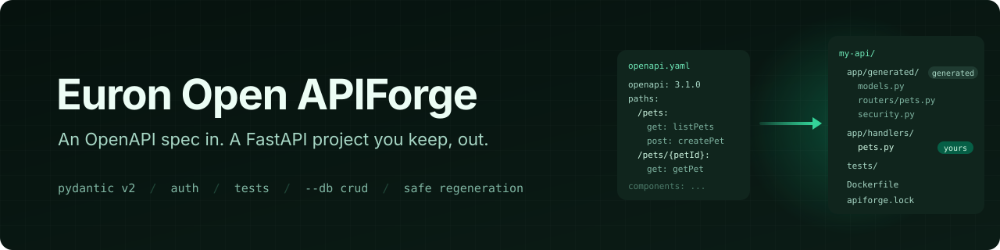
</p>

<p align="center">
  
  <a href="LICENSE"></a>
  
  
  
  
  
  
  
</p>

<p align="center">
  <a href="https://github.com/euron-sde-team/euron-open-apiforge/stargazers"></a>
  <a href="https://github.com/euron-sde-team/euron-open-apiforge/fork"></a>
  <a href="https://github.com/euron-sde-team/euron-open-apiforge/watchers"></a>
  <br>
  <a href="https://github.com/euron-sde-team/euron-open-apiforge/issues"></a>
  <a href="https://github.com/euron-sde-team/euron-open-apiforge/pulls"></a>
  <a href="https://github.com/euron-sde-team/euron-open-apiforge/commits/main"></a>
  
  <br>
  <a href="#built-by-the-team-behind-euron"></a>
</p>

<p align="center">
  <b><a href="#-quickstart">Quickstart</a></b> ·
  <b><a href="#️-the-cli">CLI</a></b> ·
  <b><a href="#️-architecture">Architecture</a></b> ·
  <b><a href="docs/api/openapi.yaml">API reference</a></b> ·
  <b><a href="#️-deploy-to-aws">Deploy</a></b> ·
  <b><a href="docs/architecture/security.md">Security</a></b> ·
  <b><a href="#-documentation">Docs</a></b>
</p>

**Euron Open APIForge** is an open-source, MIT-licensed OpenAPI to FastAPI generator, part of
the open-source initiative of **ENGAGESPHERE TECHNOLOGY PRIVATE LIMITED**. Give it an
OpenAPI 3.0 or 3.1 spec and it writes a complete FastAPI project: Pydantic v2 models with the
spec's rules, routes for every operation, the security schemes the spec declares, optional
SQLAlchemy persistence with Alembic, tests, Docker and CI. The project runs as a working mock
the moment it is generated, and it keeps working as you change the spec, because your code and
the generated code never share a file.

- **A project, not a stub.** `uv sync && uv run uvicorn app.main:app` and every operation
  answers with example data that matches the spec. ruff, mypy `--strict` and the generated
  tests pass out of the box.
- **It is the spec.** A generated test compares the OpenAPI document the app serves with the
  spec it came from. Anything APIForge can only approximate is reported, with a JSON pointer,
  before you generate.
- **Your code survives regeneration.** Handlers live in `app/handlers/`, generated code in
  `app/generated/`. Regenerating appends stubs for new operations, keeps yours, and refuses to
  overwrite a generated file you edited by hand.
- **Offline and deterministic.** The `apiforge` CLI needs no account and no network. The same
  spec and options give the same bytes, from the CLI or the web app.
- **A web app for teams.** Projects with spec history and diffs, a lint playground, a
  generation queue run by workers, a file browser, zip downloads and read-only keys for CI.

<p align="center">
  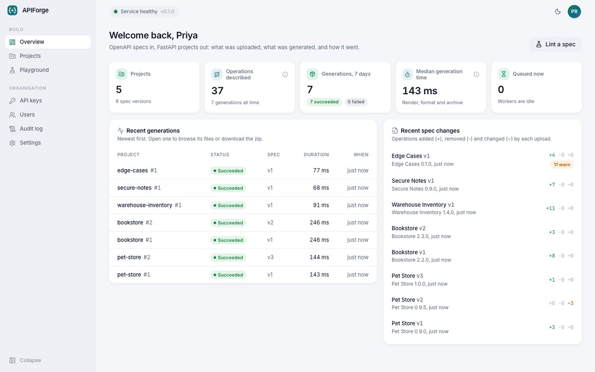
</p>

> [!NOTE]
> Everything in the tour ran for real: Docker Compose on a laptop, with S3 and KMS emulated
> locally and provisioned by the same Terraform modules that build production. The projects
> come from the five bundled example specs; every generation in it was produced by the worker
> from those specs. `make up && make demo` reproduces it.

<h3 align="center">Built by the team behind Euron</h3>

<p align="center">Euron Open APIForge comes from the people who build these platforms. If you like how this repository is built, come and see what we build with it.</p>

<p align="center">
  <a href="https://euron.one"><picture><source media="(prefers-color-scheme: dark)" srcset="docs/assets/brand/euron-dark.svg"></picture></a>
  <a href="https://euronsystems.com"><picture><source media="(prefers-color-scheme: dark)" srcset="docs/assets/brand/euron-systems-dark.svg"></picture></a>
  <a href="https://alphaeuron.com"><picture><source media="(prefers-color-scheme: dark)" srcset="docs/assets/brand/alpha-euron-dark.svg"></picture></a>
</p>

<p align="center">
  <a href="https://www.instagram.com/euron_official"></a>
  <a href="https://www.linkedin.com/company/euronone/posts/"></a>
  <a href="https://x.com/euron712"></a>
  <a href="https://www.youtube.com/@Euron-official"></a>
  <a href="https://whatsapp.com/channel/0029VaeeJwq9RZAfPW9P2l07"></a>
</p>

---

## 📚 Table of contents

- [Why APIForge](#-why-apiforge)
- [At a glance](#-at-a-glance)
- [Screenshots](#️-screenshots)
- [Features](#-features)
- [Architecture](#️-architecture)
- [Performance](#-performance)
- [Tech stack](#-tech-stack)
- [Prerequisites](#-prerequisites)
- [Quickstart](#-quickstart)
- [The CLI](#️-the-cli)
- [Explore the repository](#-explore-the-repository)
- [API](#-api)
- [Configuration](#️-configuration)
- [Deploy to AWS](#️-deploy-to-aws)
- [Security model](#-security-model)
- [Testing](#-testing)
- [Documentation](#-documentation)
- [Roadmap](#️-roadmap)
- [FAQ](#-faq)
- [Contributing, security and license](#-contributing-security-and-license)

## 💡 Why APIForge

Design-first teams write the OpenAPI spec before the code, then lose it: a generator writes a
server stub once, people fill it in, and from then on the spec and the code drift apart,
because regenerating would overwrite the work. The spec stays in the repo as documentation
that is slowly becoming wrong.

APIForge is built around the second generation, not the first:

- **Generation gap.** Everything APIForge writes lives in `app/generated/` and is rewritten
  every time; everything you write lives in files it creates once and never touches. A lock
  file records the hash of every generated file, so a hand edit is a conflict you see, not
  work you lose.
- **Fidelity you can check.** Each generated project carries a test that compares the
  OpenAPI document the running app serves with the spec. Constructs that FastAPI and Pydantic
  cannot express exactly (an XML body, a `deepObject` parameter, a `not` keyword) are listed
  by `apiforge lint` as warnings with a pointer into the spec, never dropped silently.
- **Production defaults.** Auth that fails closed, settings that refuse weak secrets in
  production, a non-root Docker image with a health check, CI, and, with `--db`, CRUD that
  passes its tests on SQLite and on Postgres.

## 📊 At a glance

| | |
| --- | --- |
| **Input** | OpenAPI 3.0 and 3.1, YAML or JSON, a single file, a folder or a zip with relative `$ref`s; URL refs are refused |
| **Output** | FastAPI project: Pydantic v2 models, routers, security, handlers, mock data, tests, `pyproject.toml` (uv), Dockerfile, Compose, CI, README |
| **Security schemes** | HTTP bearer (JWT), OAuth2 with scopes, OpenID Connect, API key in a header, query or cookie, HTTP basic |
| **Persistence** | `--db`: SQLAlchemy 2 async tables, an Alembic migration and CRUD with paging and filters for collection resources |
| **Regeneration** | Generation gap, `apiforge.lock`, stubs appended for new operations, `apiforge diff` to preview |
| **Service** | Projects, spec versions with diffs, lint playground, worker queue on Postgres, file browser, zips with ETags, roles, read-only API keys, audit log |
| **Infrastructure** | 9 Terraform modules, 3 environments; the full AWS stack applied end to end against Floci |
| **Tests** | 75 generator unit, 12 corpus projects, 51 API unit, 57 integration (under 4 backend combinations), 43 web, 17 browser end to end, a browser QA sweep of 88 pages |
| **License** | MIT |

## 🖼️ Screenshots

<table>
  <tr>
    <td width="50%">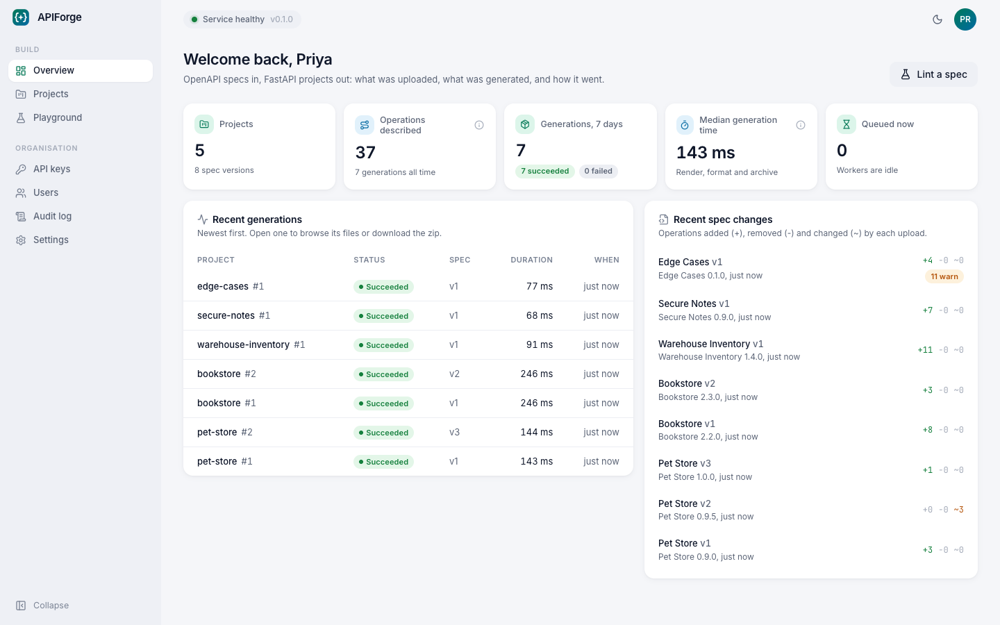<br><sub><b>Overview.</b> Projects, operations, generations this week and their median time, recent generations and spec changes.</sub></td>
    <td width="50%">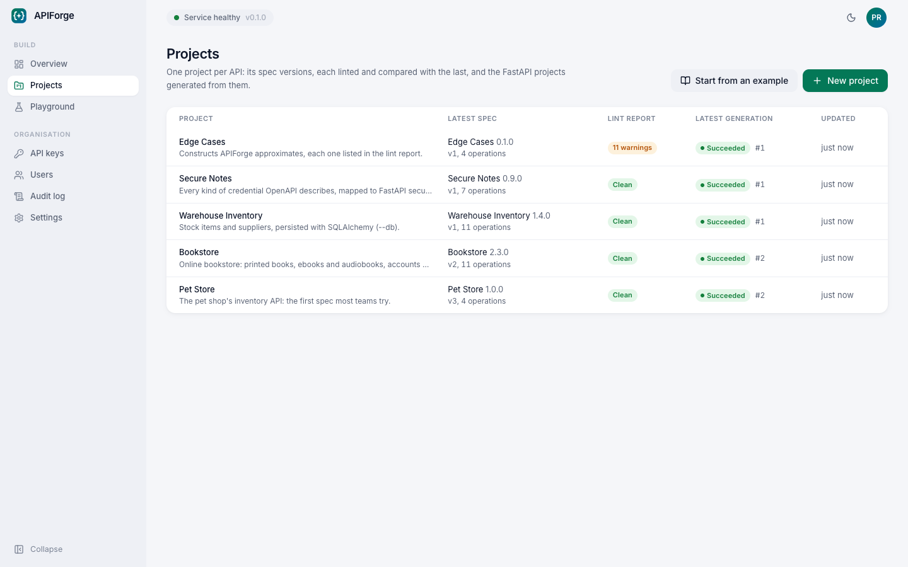<br><sub><b>Projects.</b> Each project's latest spec, its lint counts and its latest generation; start one from a bundled example.</sub></td>
  </tr>
  <tr>
    <td>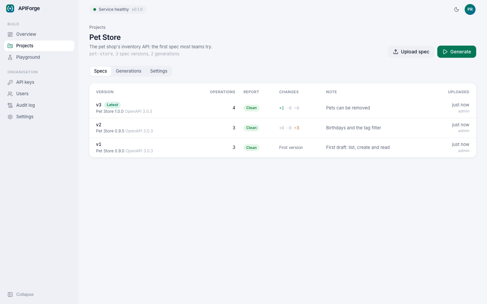<br><sub><b>Spec versions.</b> Every upload is a version: linted, stored and compared with the one before.</sub></td>
    <td>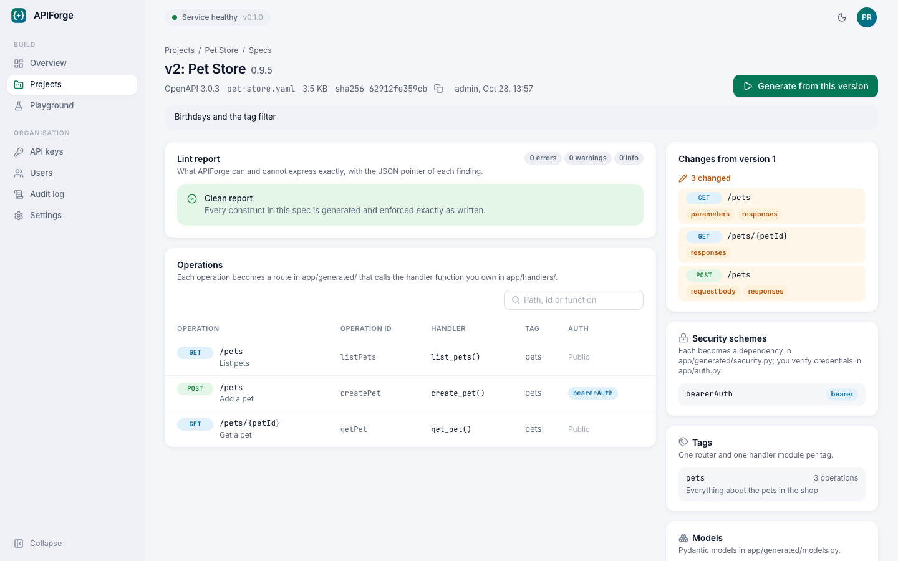<br><sub><b>A spec version.</b> Lint report, operations with their handler names, what changed since the last version, security schemes and models.</sub></td>
  </tr>
  <tr>
    <td>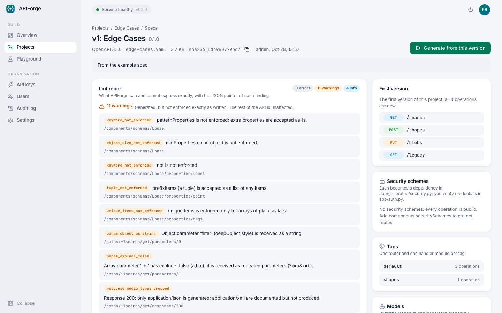<br><sub><b>Nothing dropped silently.</b> What APIForge can only approximate, with a code and a JSON pointer into the spec.</sub></td>
    <td>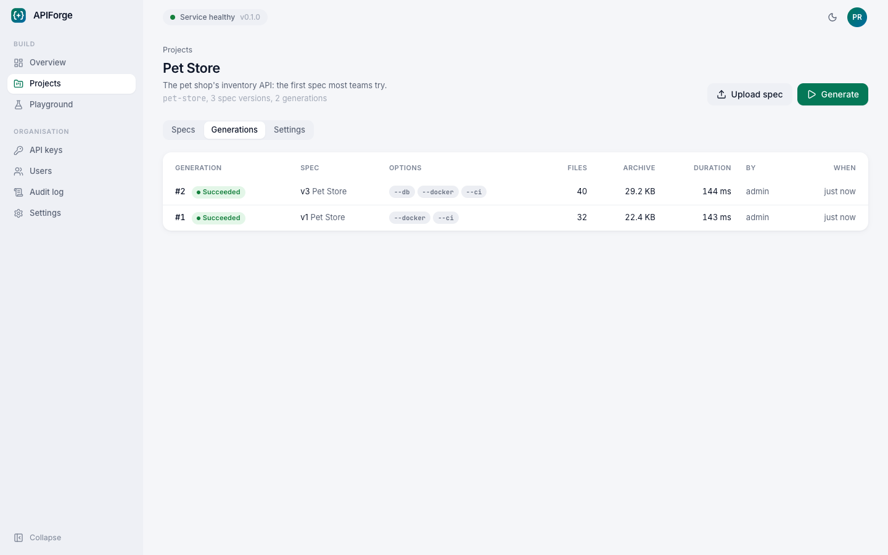<br><sub><b>Generations.</b> Queued, running and finished generations, with their options, duration and archive size.</sub></td>
  </tr>
  <tr>
    <td>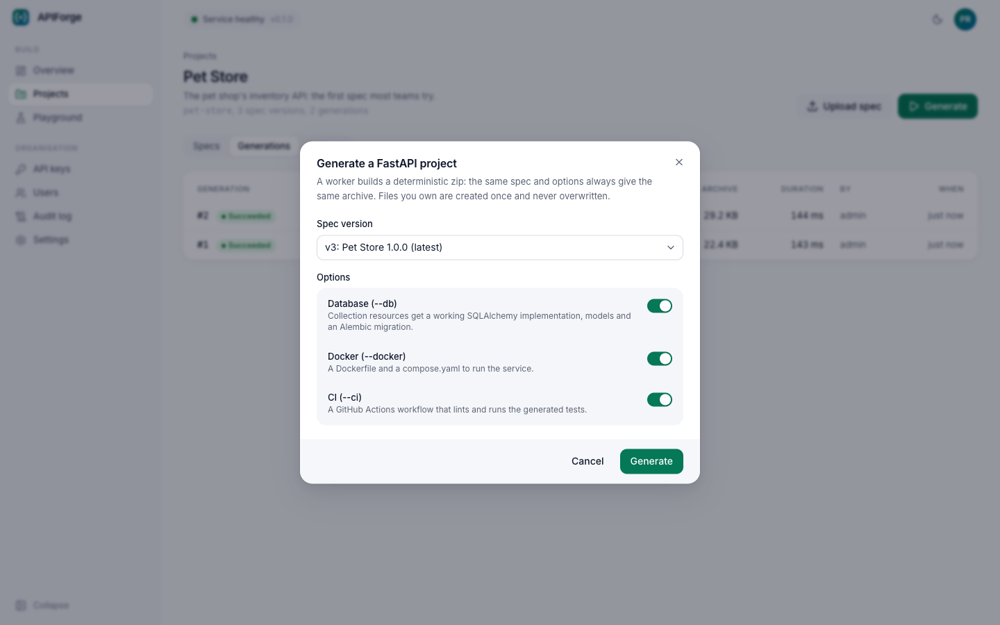<br><sub><b>Generate.</b> Pick a spec version and options; errors in the report must be accepted first.</sub></td>
    <td>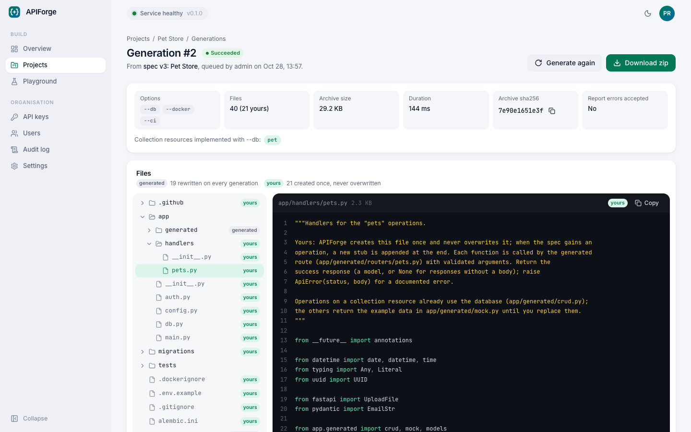<br><sub><b>Generated files.</b> Browse the project before you download it; every file is marked generated or yours.</sub></td>
  </tr>
  <tr>
    <td>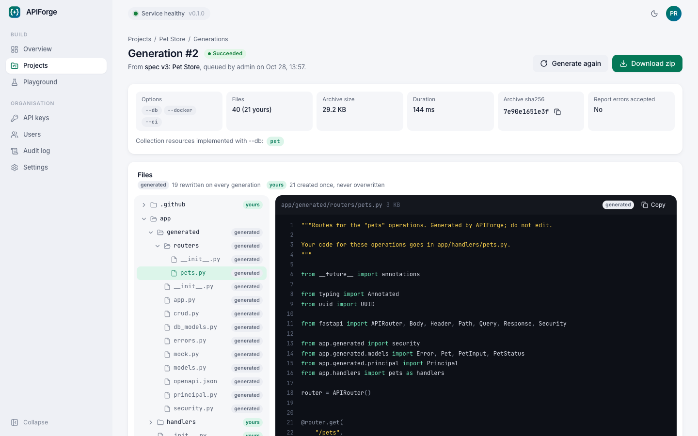<br><sub><b>Generated code.</b> A router: spec names on the wire, Python names in your code, every documented response.</sub></td>
    <td>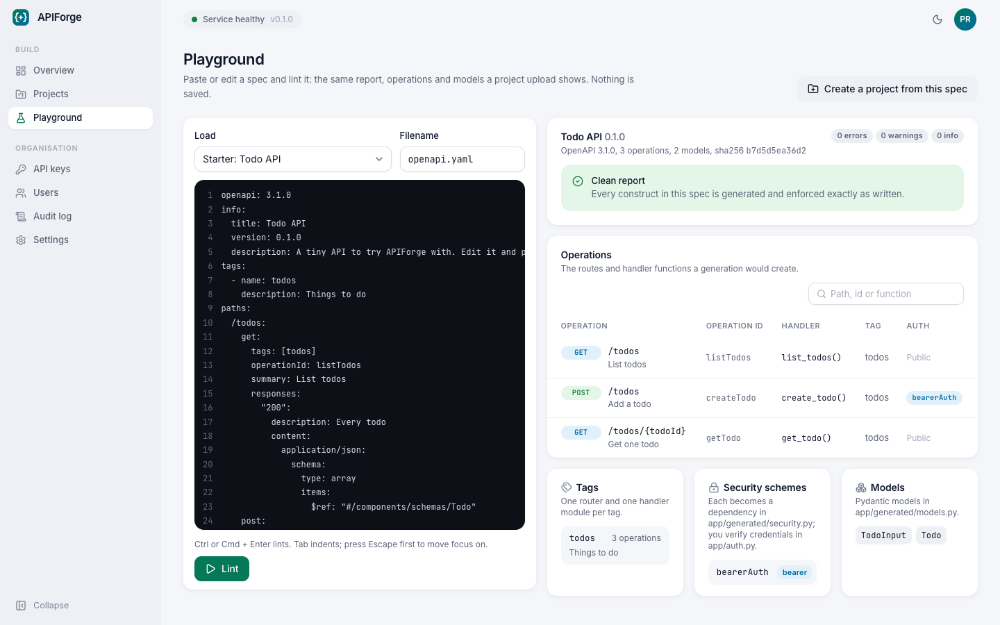<br><sub><b>Playground.</b> Paste or load a spec and lint it without saving anything; turn it into a project in one click.</sub></td>
  </tr>
  <tr>
    <td>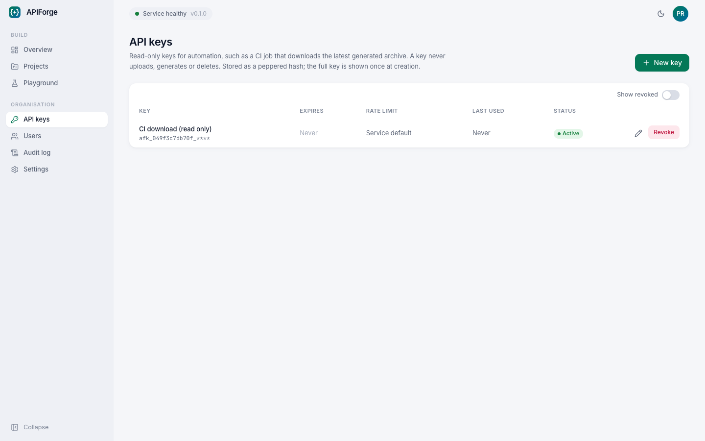<br><sub><b>API keys.</b> Read-only keys for CI to download archives, with expiry and rate limits.</sub></td>
    <td>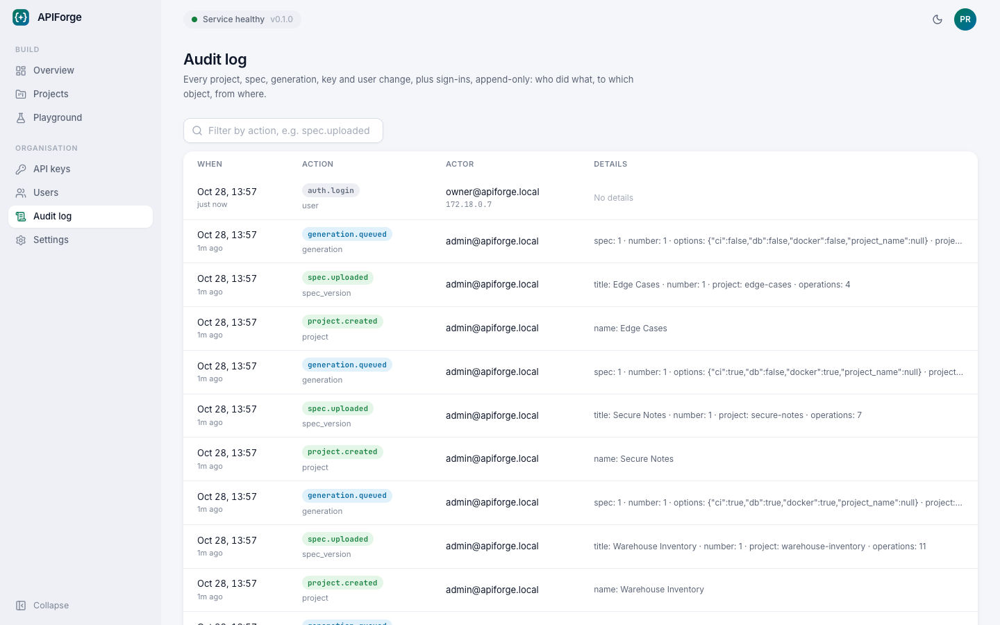<br><sub><b>Audit log.</b> Every change, append only, enforced by the database.</sub></td>
  </tr>
  <tr>
    <td>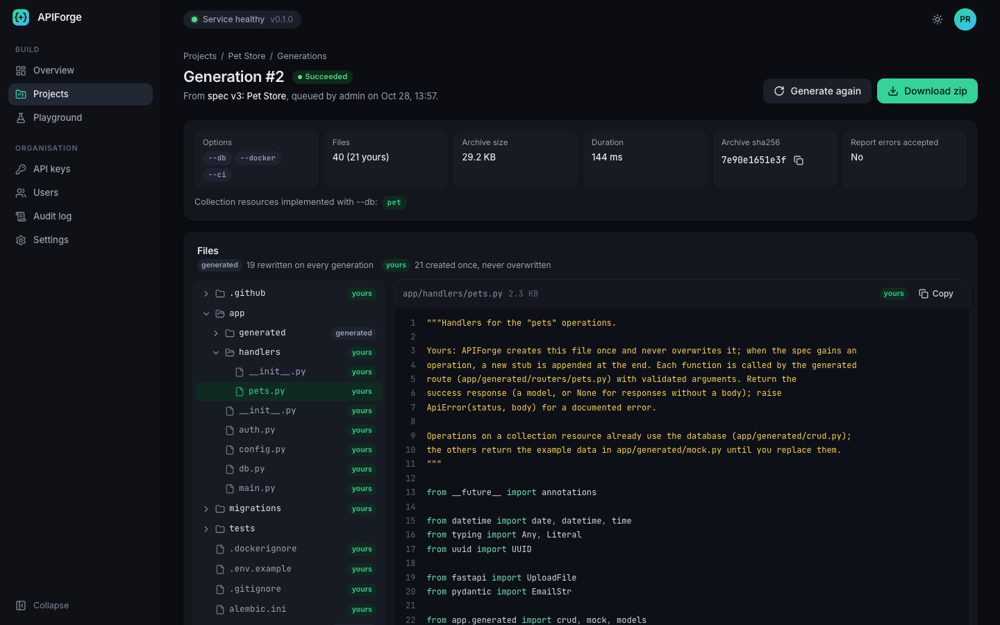<br><sub><b>Dark mode.</b> The file browser in the dark theme.</sub></td>
    <td align="center">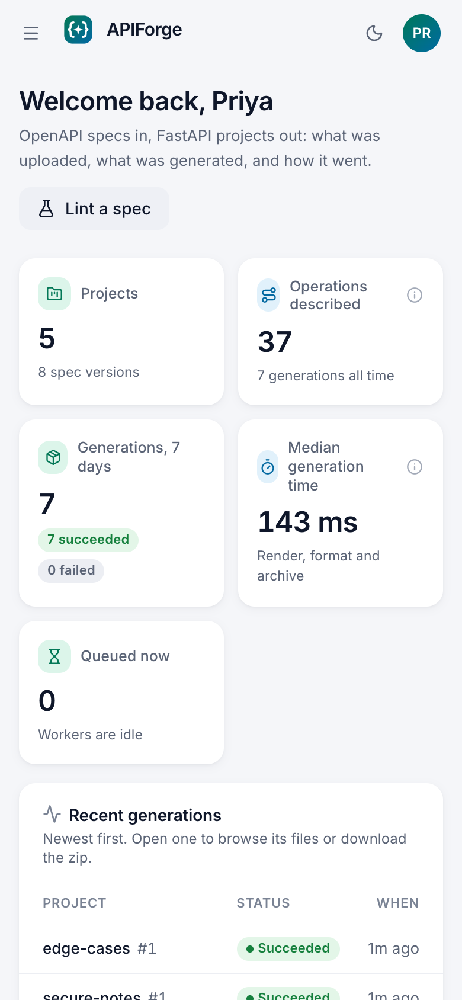<br><sub><b>Phone.</b> Responsive down to phone width.</sub></td>
  </tr>
  <tr>
    <td>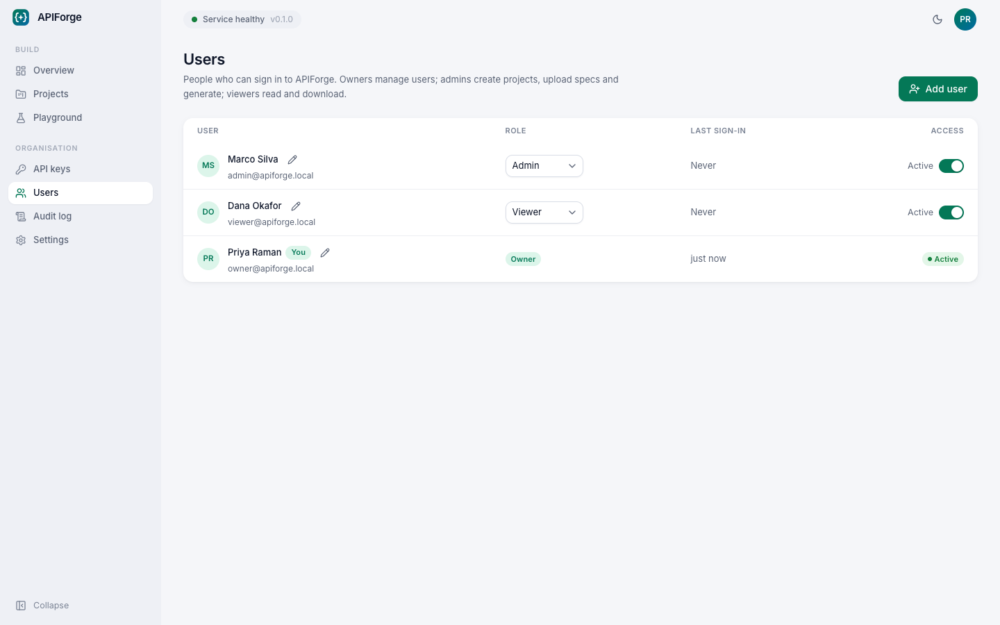<br><sub><b>Users.</b> Owner, admin and viewer roles.</sub></td>
    <td>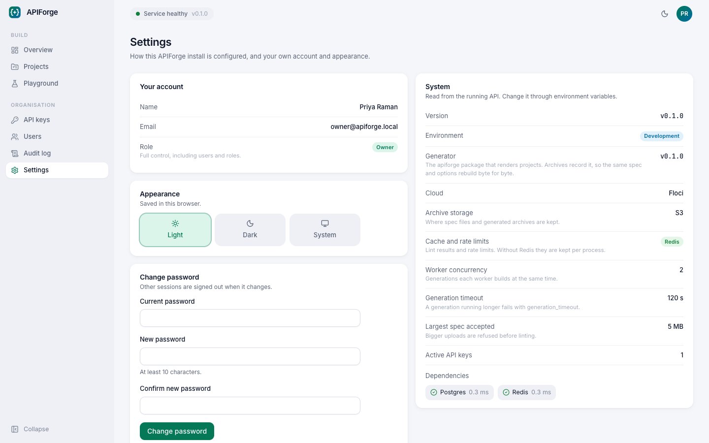<br><sub><b>Settings.</b> How the deployment is configured, and the health of its dependencies.</sub></td>
  </tr>
</table>

## ✨ Features

<table>
<tr>
<td valign="top" width="50%">

#### 📐 Models and routes
- **Pydantic v2** with required fields, formats, enums, lengths, ranges and patterns.
- **Composition**: `allOf` inheritance, `oneOf` and `anyOf` (discriminated when the spec
  says so), nullable fields, recursive models, separate input models for `readOnly` and
  `writeOnly`.
- **Parameters** in the path, query, header and cookie; JSON, form and multipart bodies;
  file upload and download; every documented response.

</td>
<td valign="top" width="50%">

#### 🔐 Auth and persistence
- **Security from the spec**: missing or bad credentials get 401, missing scopes 403.
- **Fail closed**: a scheme without its secret configured refuses every request.
- **`--db`**: SQLAlchemy 2 tables, an Alembic migration and working CRUD for
  `/things` and `/things/{id}`, with paging and filters, on SQLite or Postgres.

</td>
</tr>
<tr>
<td valign="top">

#### 🔁 Regeneration
- **Generation gap**: generated code and yours in separate files.
- **Lock file** with the hash of every generated file; hand edits are conflicts.
- **New operations** get a stub appended to their handler module; removed ones are
  reported and their handlers kept.
- **`apiforge diff`** shows what a regeneration would change.

</td>
<td valign="top">

#### 🏭 The service
- **Spec history**: idempotent uploads by SHA-256, changes by operation fingerprint.
- **Workers** on a Postgres queue with leases and retries, safe to scale out.
- **Archives** byte for byte equal to the CLI's, served with ETags; a revalidation is a 304 that never reads storage.
- **Roles**, read-only API keys, an append-only audit log, Prometheus metrics.

</td>
</tr>
</table>

## 🏗️ Architecture

<p align="center">
  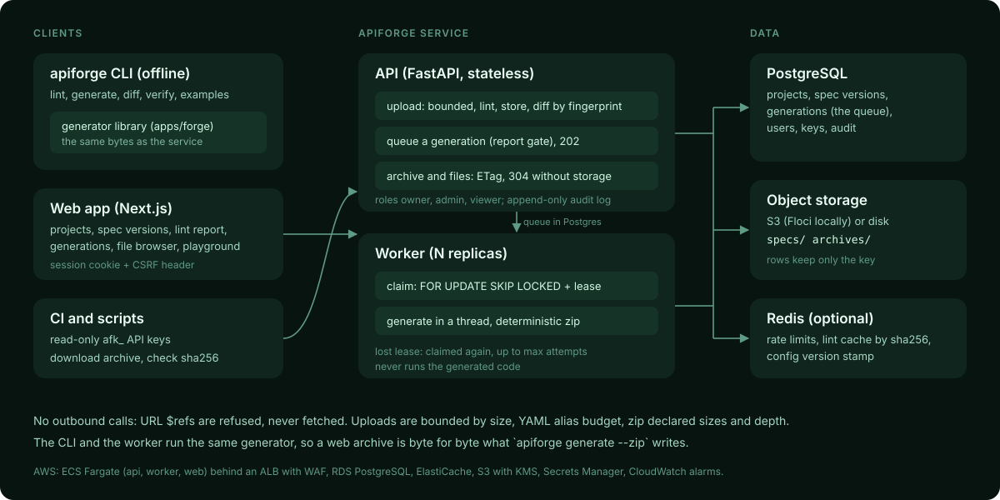
</p>

The generator is a library (`apps/forge`) that the CLI and the service both import. It loads
the spec within strict budgets, validates it, normalizes it into an intermediate
representation, compiles schemas into Pydantic models, plans the FastAPI project and renders
it from sandboxed templates, then formats it with a pinned ruff configuration. The service
(`apps/api`) lints every upload, keeps the bytes in object storage and the metadata in
Postgres, and queues generations that a worker claims with `FOR UPDATE SKIP LOCKED` and a
lease. The worker never runs the generated code, and nothing in the system makes an outbound
call. Details: [HLD](docs/architecture/HLD.md), [the generator](docs/architecture/generator.md),
[regeneration](docs/architecture/regeneration.md), [fidelity](docs/architecture/fidelity.md),
[the service](docs/architecture/service.md).

## ⚡ Performance

Measured with `make bench` against the production images in Docker Compose on a laptop
(Apple silicon, Docker Desktop), over HTTP, one worker with concurrency 2.

| | p50 | p95 |
| --- | ---: | ---: |
| Lint the bookstore spec (11 operations), not cached | 72.7 ms | 80.0 ms |
| Lint the same spec again (cached by content) | 3.9 ms | 5.1 ms |
| Upload a spec version (lint, store, diff) | 18.6 ms | 28.1 ms |
| A generation in the worker, claimed to stored | 107.5 ms | 121.0 ms |
| Download an archive | 4.6 ms | 5.5 ms |
| View a generated file (cached archive) | 3.4 ms | 3.8 ms |
| List projects | 5.0 ms | 6.2 ms |
| Overview | 5.7 ms | 6.9 ms |

Twenty generations queued at once all finished in 1.8 s: 11 a second from one worker. The
generator alone takes 72 to 121 ms per bundled spec in process, including the zip; a
240-operation spec generates in under a second. The API and the worker are stateless, so more
replicas add more.

## 🧰 Tech stack

| Layer | Technology |
| --- | --- |
| Generator | Python 3.12, openapi-spec-validator, PyYAML (safe loader), Jinja2 (sandboxed), ruff as a formatter |
| Generated project | FastAPI, Pydantic v2, pydantic-settings, PyJWT, SQLAlchemy 2 and Alembic (`--db`), pytest, uv |
| API and worker | FastAPI, SQLAlchemy 2 (async, asyncpg), Alembic, Pydantic v2, redis-py, boto3 |
| Web | Next.js 15 (App Router), React 19, TypeScript, Tailwind CSS 4, shadcn components, TanStack Query, Prism |
| Data | PostgreSQL 16, Redis 7 (optional; Valkey on AWS), S3 |
| AWS | ECS Fargate, ALB, WAF, RDS, ElastiCache, S3, KMS, Secrets Manager, ECR, CloudWatch |
| Local | Docker Compose, Floci (AWS emulator) |
| Quality | pytest, Hypothesis, Vitest, Playwright, Puppeteer, ruff, mypy `--strict`, ESLint, tflint, checkov |

## 📋 Prerequisites

- Docker with Compose v2
- `make`, `bash`, `openssl`
- For the CLI and development outside containers: Python 3.12 with
  [uv](https://docs.astral.sh/uv/), Node 22 and pnpm 9

## 🚀 Quickstart

The web app and the service:

```bash
git clone https://github.com/euron-sde-team/euron-open-apiforge.git
cd euron-open-apiforge
make up      # Postgres, Redis, Floci (provisioned by Terraform), api, worker, web
make demo    # users, five projects from the bundled specs, generations; prints the logins
```

Open http://localhost:4610 and sign in with a printed login. Download a generated project from
a script with the printed read-only key:

```bash
curl -H "Authorization: Bearer afk_..." http://localhost:4630/api/v1/projects/pet-store/generations
curl -H "Authorization: Bearer afk_..." -o pet-store.zip \
  http://localhost:4630/api/v1/projects/pet-store/generations/2/archive
```

[The quickstart guide](docs/guides/quickstart-local.md) walks through every screen.
`make down` removes everything.

## ⌨️ The CLI

No server needed:

```bash
cd apps/forge && uv sync
uv run apiforge lint openapi.yaml                      # findings with JSON pointers; exit 1 on errors
uv run apiforge generate --spec openapi.yaml -o my-api # or --zip my-api.zip, --db for persistence
cd my-api && uv sync && uv run uvicorn app.main:app --reload
```

Open http://localhost:8000/docs: every operation already answers with example data. Then
implement `app/handlers/`, change the spec and run `apiforge generate` into the same folder
again. `apiforge diff` previews a regeneration, `apiforge verify my-api` installs the project
and runs its lint, type check and tests, and `apiforge examples --copy specs/` gives you the
five bundled specs. [CLI reference](docs/guides/cli.md),
[the generated project](docs/guides/generated-project.md).

## 🧭 Explore the repository

```text
euron-open-apiforge/
├── apps/
│   ├── forge/               euron-apiforge: the generator library and the apiforge CLI
│   │   └── src/apiforge/
│   │       ├── loader.py bundles.py     budgets, safe YAML, zips, local $refs only
│   │       ├── normalize.py schemas.py  the intermediate representation, JSON Schema to Pydantic
│   │       ├── crud.py examples.py      collection resources for --db, example data
│   │       ├── generator.py writer.py   generate, the generation gap and apiforge.lock
│   │       ├── fidelity.py verify.py    served OpenAPI against the spec, project gates
│   │       ├── targets/fastapi/         the planner and 35 templates
│   │       └── corpus/                  five example specs, from a pet store to edge cases
│   ├── api/                 apiforge_server: API, worker, CLI, benchmark, demo seed
│   │   └── src/apiforge_server/
│   │       ├── projects/        projects, spec versions, analysis, the playground, examples
│   │       ├── generations/     the queue, the worker run, archives and files
│   │       ├── overview/ auth/ users/ keys/ audit/ system/ observability/
│   │       ├── core/            config, db, optional KV, cache, errors, security, storage
│   │       └── worker.py        the worker loop
│   └── web/                 Next.js web app (features/<domain>, components, lib)
├── examples/                a CI download script, a GitHub Actions check, a tiny spec
├── infra/
│   ├── terraform/           modules + envs (local-floci, aws-dev, aws-prod)
│   └── docker/              api and web images
├── deploy/compose/          the local stack (Floci or real AWS overlay)
├── e2e/                     Playwright browser tests
├── scripts/                 QA sweep and screenshots, test matrix, sanitization check
└── docs/                    architecture, ADRs, guides, OpenAPI
```

## 🔌 API

Everything the web app shows comes from the REST API under `/api/v1`, described in the
[OpenAPI reference](docs/api/openapi.yaml) (interactive at `/docs`). Automation uses read-only
`afk_` keys; the web app uses a session cookie with a CSRF header. Errors share one envelope
`{"error": {"code", "message", "details"}}`.

| Area | Endpoints |
| --- | --- |
| Projects | `/projects`, `/projects/{slug}`, `/projects/from-example` |
| Specs | `/projects/{slug}/specs` (file upload), `/specs/text`, `/specs/{number}`, `/specs/{number}/content`, `/projects/{slug}/diff` |
| Generations | `/projects/{slug}/generations`, `/generations/{number}`, `/generations/{number}/archive`, `/generations/{number}/file` |
| Playground | `/lint`, `/examples`, `/examples/{name}` |
| People | `/auth/*`, `/users`, `/keys`, `/audit` |
| Operations | `/overview`, `/system`, `/healthz`, `/readyz`, `/metrics` (optionally behind `METRICS_TOKEN`) |

## ⚙️ Configuration

All settings are environment variables, validated at boot; production refuses unsafe ones.
The most important:

| Variable | Default | |
| --- | --- | --- |
| `REDIS_URL` | empty | Empty runs without Redis (per-process rate limits and caches) |
| `STORAGE` | `local` | `s3` for the artifacts bucket (required in production) |
| `MAX_SPEC_BYTES` | 5 MiB | Largest spec upload, for files, text and the playground |
| `WORKER_CONCURRENCY` | `2` | Generations one worker runs at a time |
| `GENERATION_TIMEOUT_S` | `120` | Longest a generation may take; the lease is this plus 30 s |
| `GENERATION_MAX_ATTEMPTS` | `3` | Claims before a generation whose worker keeps dying fails with `worker_lost` |
| `METRICS_TOKEN` | empty | Require a bearer token on `/metrics` |

The full list, and the settings of a generated project (`JWT_SECRET`, `API_KEYS`,
`DATABASE_URL` and the rest), are in the [configuration reference](docs/guides/configuration.md).

## ☁️ Deploy to AWS

```bash
cp infra/terraform/envs/aws-dev/terraform.tfvars.example infra/terraform/envs/aws-dev/terraform.tfvars
make aws-deploy ENV=aws-dev TAG=0.1.0      # registries, images, apply, migrations, wait
APIFORGE_OWNER_PASSWORD=... make aws-admin ENV=aws-dev EMAIL=you@example.com   # first owner
```

This creates a VPC, RDS PostgreSQL, ElastiCache, an encrypted artifacts bucket (archives
expire, specs are kept), a KMS key, Secrets Manager entries, ECR, ECS Fargate services for the
api, worker and web behind an ALB with WAF, and CloudWatch alarms. The maintainers develop
against the local emulator; the AWS environments pass `terraform validate`, tflint and
checkov, and the full `aws-dev` stack is applied, re-planned and destroyed against Floci
(`make tf-aws-on-floci`). Step by step: [deploy guide](docs/guides/deploy-aws.md).

## 🔐 Security model

| Area | How |
| --- | --- |
| Hostile specs | Size, depth, YAML alias and `$ref` expansion budgets; zip declared sizes, unsafe paths and unreadable members refused; URL `$ref`s refused, never fetched; every spec string escaped as a Python literal, docstring or comment before it reaches generated code (Hypothesis property tests) |
| Generated code | Never executed by the service; a lock file from disk can only name files in the generated folders; formatted and type checked in the corpus suite; auth that fails closed and production guards for weak secrets |
| Service | argon2id, atomic lockout and per-IP throttling, owner, admin and viewer roles enforced in the API, CSRF header, CSP and HSTS, sessions ended on sign-out, password or role change |
| Keys | `afk_` keys stored only as peppered HMACs, shown once, read only and rate limited |
| Data | Specs and archives in a private, KMS-encrypted bucket, rows keep only keys; an append-only audit log enforced by a database trigger |
| Infrastructure | Private subnets, TLS, least-privilege task roles, WAF, `/metrics` restricted, checkov clean |

Report vulnerabilities privately: see [SECURITY.md](SECURITY.md). Details:
[security](docs/architecture/security.md), [threat model](docs/architecture/threat-model.md).

## 🧪 Testing

| Suite | What it proves | Run |
| --- | --- | --- |
| Generator unit (75) | Loader and expansion budgets, hostile input (Hypothesis), hostile zips and lock files, normalization, example data that validates, fidelity comparison, determinism, the writer and lock file, the CLI, no network | `make test` |
| Corpus (12) | Each of the five bundled specs, with and without `--db`, a hostile spec and a 240-operation spec generate a project whose own ruff, mypy `--strict` and tests pass, including the round trip of the served OpenAPI; the `--db` projects pass their tests again on Postgres | `make test-corpus` |
| API unit (51) | Config guards, security primitives, storage, the archive cache bounds, slugs, the OpenAPI drift check | `make test` |
| Web (43) | The file tree, status chips, spec change summaries, lint grouping and errors, formatting, navigation and roles, components | `make test` |
| Integration (57) | The real API and worker against Postgres, Redis and Floci: uploads and idempotency, diffs, the report gate, the web archive equal to the CLI's bytes, ETags and 304s, lease retry, fencing and `worker_lost`, concurrent claims, zip and YAML bombs, URL refs never fetched, filename traversal, RBAC and read-only keys | `make test-integration` |
| Option matrix (4 runs) | The integration suite under every cache and storage backend (Redis or none, disk or S3) | `make test-matrix` |
| Browser (17) | Sign in and out with safe redirects, a project from upload to download, the report gate, the playground, project settings, read-only keys against the API, users and roles, the theme | `make e2e` |
| Browser QA (88 pages) | Every page in light and dark at desktop and phone width: no console errors, failed requests, broken images, overflow or unexplained empty states | `make qa` |
| Infrastructure | `terraform validate` (3 environments), tflint, checkov, sanitization (secrets, account ids, em and en dashes) | `make tf-validate tf-lint tf-security sanitize` |
| AWS on Floci | The full production environment plans, applies, converges and destroys against an AWS API | `make tf-aws-on-floci` |

Line coverage from the unit and integration suites: 91% of `apps/api/src`, 88% of
`apps/forge/src` from its unit tests alone. [Testing guide](docs/guides/testing.md)

## 📖 Documentation

| Architecture | Guides |
| --- | --- |
| [High-level design](docs/architecture/HLD.md) | [Quickstart (local)](docs/guides/quickstart-local.md) |
| [Low-level design](docs/architecture/LLD.md) | [The CLI](docs/guides/cli.md) |
| [The generator](docs/architecture/generator.md) | [The generated project](docs/guides/generated-project.md) |
| [Regeneration](docs/architecture/regeneration.md) | [Configuration reference](docs/guides/configuration.md) |
| [Fidelity](docs/architecture/fidelity.md) | [Deploy to AWS](docs/guides/deploy-aws.md) |
| [The service](docs/architecture/service.md) | [Local against real AWS](docs/guides/local-with-aws.md) |
| [Data model](docs/architecture/data-model.md) | [Operations runbook](docs/guides/operations.md) |
| [Security](docs/architecture/security.md) and [threat model](docs/architecture/threat-model.md) | [Testing](docs/guides/testing.md) |
| [Decision records](docs/architecture/adr/) | [Troubleshooting](docs/guides/troubleshooting.md) |
| [API reference (OpenAPI)](docs/api/openapi.yaml) | [Code walkthrough](docs/guides/walkthrough.md) |

## 🗺️ Roadmap

- AI-assisted handlers: optional, reviewed suggestions for handler bodies from the spec's
  descriptions and examples, never applied without you
- More targets next to FastAPI (a typed Python client first)
- JWKS for bearer and OpenID Connect verification, and token issuing helpers
- Webhooks and callbacks from OpenAPI 3.1
- Per-project access control in the service
- Swagger 2.0 input through an upgrade step

Have an idea? [Open a feature request](https://github.com/euron-sde-team/euron-open-apiforge/issues/new/choose).

## ❓ FAQ

<details>
<summary><b>Will regenerating overwrite my code?</b></summary>

No. Generated files are only the ones under `app/generated/` and `tests/generated/`;
everything else is created once and never touched again. If you edit a generated file by hand,
`apiforge generate` stops and tells you which file, instead of overwriting it (`--force`
overwrites anyway).
</details>

<details>
<summary><b>What happens to parts of my spec FastAPI cannot express?</b></summary>

They are generated as closely as possible and listed by `apiforge lint` as warnings, each with
a code and a JSON pointer, for example an XML response or a `deepObject` parameter. Anything
that would change what the API accepts, such as two routes with the same shape, is an error that
blocks generation until you accept the report. The generated fidelity test knows about the
accepted approximations and checks everything else exactly.
</details>

<details>
<summary><b>Does it use AI?</b></summary>

Not in 0.1.0. Generation is deterministic: the same spec and options give the same bytes, which
is what makes regeneration and review safe. Optional AI-assisted handler bodies are on the
roadmap, as suggestions you review.
</details>

<details>
<summary><b>Do I need the web app?</b></summary>

No. The `apiforge` CLI is the whole generator and works offline. The web app adds a shared
history of specs and generations for a team, and archives that CI can download with a read-only
key.
</details>

<details>
<summary><b>Is it safe to run on specs from someone else?</b></summary>

That is the threat model. Specs are parsed with budgets on size, depth and YAML alias expansion,
URL references are never fetched, zip entries with unsafe paths are refused, and every string
from the spec is escaped before it reaches generated code. The service never runs what it
generates.
</details>

<details>
<summary><b>Do I need an AWS account to try it?</b></summary>

No. `make up` runs everything on Docker, with S3 and KMS on a local emulator provisioned by the
same Terraform modules as production.
</details>

## 🤝 Contributing, security and license

Contributions are welcome: read [CONTRIBUTING.md](CONTRIBUTING.md) and the
[code of conduct](CODE_OF_CONDUCT.md). Report security issues privately as described in
[SECURITY.md](SECURITY.md).

Released under the [MIT License](LICENSE). Copyright (c) 2026 ENGAGESPHERE TECHNOLOGY
PRIVATE LIMITED and the Euron Open APIForge contributors.

<p align="center">
  If APIForge saved you writing the same FastAPI boilerplate again, <b><a href="https://github.com/euron-sde-team/euron-open-apiforge/stargazers">⭐ star the repository</a></b>.
</p>
