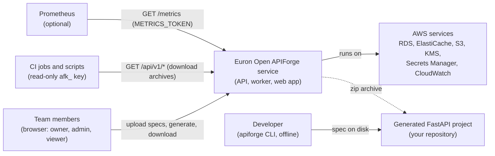
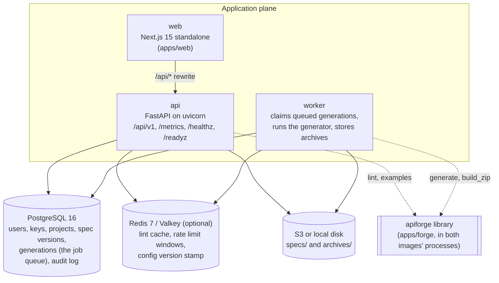
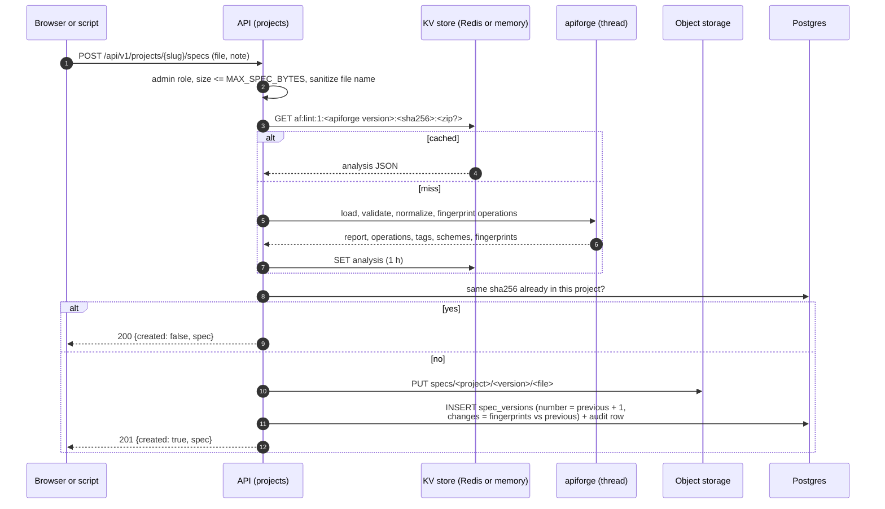
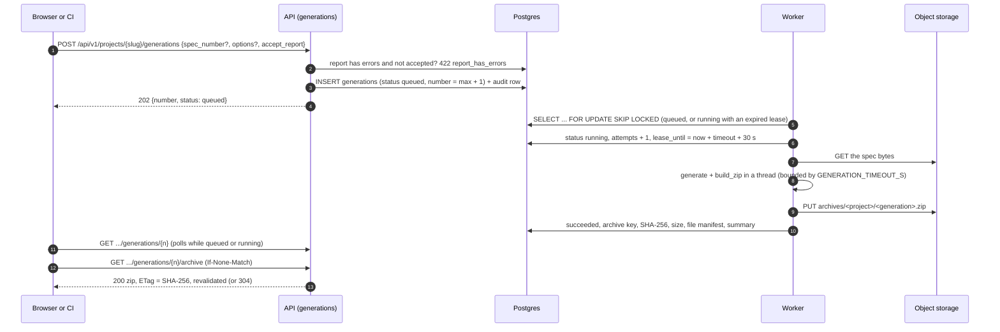

# High-Level Design

This document describes what Euron Open APIForge is made of, how the pieces talk to each
other, and how the system behaves under load and failure. Module-level detail is in the
[Low-Level Design](LLD.md), the tables in the [Data Model](data-model.md), and the parts
that carry most of the correctness argument in their own documents:
[the generator](generator.md), [regeneration](regeneration.md), [fidelity](fidelity.md)
and [the service](service.md). The reasoning behind each major choice is in the
[ADRs](adr/README.md).

- [Goals and non-goals](#goals-and-non-goals)
- [System context](#system-context)
- [Containers](#containers)
- [Component responsibilities](#component-responsibilities)
- [Data flow](#data-flow)
- [The worker](#the-worker)
- [Caching layers](#caching-layers)
- [Scalability](#scalability)
- [Availability and failure modes](#availability-and-failure-modes)
- [Security summary](#security-summary)
- [Observability](#observability)
- [Key design decisions](#key-design-decisions)

## Goals and non-goals

APIForge turns an OpenAPI 3.0 or 3.1 document into a complete FastAPI project: Pydantic
models with the spec's validation rules, routes, security from the spec's schemes,
optional SQLAlchemy persistence, a test suite, Docker and CI files. It runs as a CLI with
no account and no network, and as a self-hosted service where a team uploads specs,
reviews the lint report and the changes between versions, and downloads generated
projects. The name is the contract: a forge produces something that holds up under use,
so a generated project installs, passes its own tests and type checks, serves exactly the
API the spec describes, and survives regeneration without losing your code.

**Goals**

| # | Goal | How it is met |
| - | ---- | ------------- |
| G1 | A generated project runs and passes its own gates | Every bundled spec is generated, installed and checked with ruff, mypy `--strict` and its own pytest suite (`apps/forge/tests/test_corpus.py`, `apiforge verify`) |
| G2 | The project serves the spec, nothing more and nothing less | The generated `tests/generated/test_spec.py` compares the OpenAPI document the app serves with the input spec ([fidelity.md](fidelity.md)) |
| G3 | A mock on day one | Every handler starts by returning a schema-valid example built from the spec ([generator.md](generator.md#mocks-and-examples)) |
| G4 | Regeneration keeps your code | Generated code and your code live in different files; `apiforge.lock` detects hand edits ([regeneration.md](regeneration.md)) |
| G5 | Deterministic | Same spec bytes and options, same archive bytes, on the CLI and in the service; the archive SHA-256 is its ETag ([ADR-0005](adr/0005-generator-as-a-shared-library.md)) |
| G6 | Nothing is dropped silently | The lint report lists every construct APIForge approximates or cannot express, with a JSON pointer; errors block generation until the report is accepted |
| G7 | A hostile spec is inert | Spec text reaches code only through escaping filters, the template environment is sandboxed, loading is bounded, URL `$ref`s are refused, and the server never runs generated code ([security.md](security.md)) |
| G8 | Runs on a laptop without an AWS account | The CLI needs nothing but Python; the service runs on Docker Compose with Floci provisioned by the same Terraform as production |

**Non-goals (0.1.0)**

- **AI-written handler bodies.** 0.1.0 is the deterministic generator only; an opt-in AI
  step is on the roadmap ([ADR-0001](adr/0001-deterministic-generation-first.md)).
- **Other targets.** FastAPI is the only target ([ADR-0003](adr/0003-fastapi-only-target.md)).
- **Swagger 2.0 and AsyncAPI.** Swagger 2.0 is detected and refused with a way forward.
- **Running or verifying generated code on the server.** `apiforge verify` runs on your
  machine or in your CI; the service only generates and stores archives.
- **Breaking-change classification.** Spec versions are compared as operations added,
  removed and changed (and which part changed), not classified as breaking or not.
- **Multi-tenancy.** One install serves one team; every signed-in user sees every
  project, with what they may change decided by their role.

## System context

The service has no outbound integrations: no webhooks, no mail, no calls to a spec's
servers or `$ref` URLs. Its only network peers are Postgres, Redis (optional) and S3.

## Containers

The API image runs the HTTP API (`apiforge-server serve`), the background worker
(`apiforge-server worker`) and one-off commands (`migrate`, `create-owner`, `hash-password`,
`seed-demo`, `openapi`). It carries both Python packages: the generator (`apps/forge`, import
`apiforge`) and the service (`apps/api`, import `apiforge_server`). The web image runs the
Next.js app.

## Component responsibilities

| Component | Code | Owns | Never does |
| --------- | ---- | ---- | ---------- |
| Generator | [`apps/forge/src/apiforge`](../../apps/forge/src/apiforge) | Loading and validating specs, the IR, the lint report, the FastAPI target and its templates, deterministic archives, the generation gap on disk, `verify` | Open a network connection, read the clock or environment into its output |
| CLI | [`apiforge/cli.py`](../../apps/forge/src/apiforge/cli.py) | `lint`, `generate`, `diff`, `verify`, `examples` | Need an account or a server |
| Projects | [`projects/`](../../apps/api/src/apiforge_server/projects) | Projects, spec uploads (lint, store, compare, deduplicate), the lint playground, bundled examples | Store a spec that failed to load |
| Generations | [`generations/`](../../apps/api/src/apiforge_server/generations) | Queueing, claiming with a lease, running the generator, archives, the file browser | Execute generated code |
| Worker | [`worker.py`](../../apps/api/src/apiforge_server/worker.py) | Running the generations job on its interval, graceful shutdown | Take HTTP traffic (it serves only its own `/metrics` on 9464) |
| Platform | `auth/`, `users/`, `keys/`, `audit/`, `system/`, `overview/` | Sessions, roles, read-only API keys, the append-only audit log, health, `/metrics`, the overview | Let an API key write |
| Web app | [`apps/web`](../../apps/web) | Every screen; same-origin proxy of `/api` to the API | Hold a credential other than the httpOnly session cookie |

## Data flow

### Uploading a spec version

A spec that cannot be loaded or validated is refused with 422, the generator's error code
(for example `spec_invalid` or `spec_too_complex`) and the reason; nothing is stored. A spec that loads but has findings is stored with its report.

### Generating and downloading

The file browser reads one file at a time (`GET .../generations/{n}/file?path=...`): the
path must be in the generation's manifest, and the archive is unpacked once per API
process and kept by its SHA-256.

## The worker

The worker is one loop that runs the generations job
([`worker.py`](../../apps/api/src/apiforge_server/worker.py)). While passes find work it
runs the next pass right away (the job's `busy` flag), so a queue drains back to back; when
a pass finds nothing, it waits `WORKER_POLL_S` (1 s) before looking again. A failing pass is logged,
counted in `apiforge_job_failures_total` and retried on the next turn. The lease, the
retry rule and every failure path are described in [service.md](service.md#the-worker).

| Job | Every | Coordination across replicas | What it does |
| --- | ----- | ---------------------------- | ------------ |
| `generations` | Right away while the previous pass found work, otherwise `WORKER_POLL_S` | `SELECT ... FOR UPDATE SKIP LOCKED` over queued rows and running rows whose lease expired, then a lease on each claimed row | Claims up to `WORKER_CONCURRENCY` generations, runs them concurrently (each in a thread), records success or a failure with a code and a message |

`SIGTERM` lets the generations in hand finish, then the worker closes its connections and
exits. A worker killed mid-job leaves its row `running` with a lease; another worker (or
the same one after a restart) picks it up when the lease expires.

## Caching layers

Every cache below is either content-addressed (the key is a SHA-256 of immutable bytes, so
it can never be stale) or a short-lived performance shortcut over Postgres. Security state
(sessions, revocations, lockouts, roles) is never kept in a cache that could be evicted.
Redis is optional ([ADR-0007](adr/0007-postgres-and-object-storage-redis-optional.md)):
with `REDIS_URL` empty, every KV use runs on an in-process bounded LRU (`MemoryKV`), which
is exact for a single API process.

| Layer | What | Where | Key design | TTL | Invalidation trigger |
| ----- | ---- | ----- | ---------- | --- | -------------------- |
| Lint cache | The full analysis of a spec: report, counts, operations, tags, schemes, model names, operation fingerprints | KV store ([`projects/analysis.py`](../../apps/api/src/apiforge_server/projects/analysis.py)) | `af:lint:<CACHE_VERSION>:<apiforge version>:<sha256 of the bytes>:<is zip>` | 1 h | None needed: the key is the content and the generator version, and the same bytes always lint the same way with the same generator, so an upgrade never serves the previous version's results. A change to what the analysis stores bumps `CACHE_VERSION` in code. Served for uploads, the playground, `GET /api/v1/examples` and creating a project from an example. A KV error is a miss (`apiforge_dependency_errors_total{dependency="kv"}`) |
| Archive files | The unpacked files of a generated archive, for the file browser | In-process `_ArchiveCache` per API process ([`generations/service.py`](../../apps/api/src/apiforge_server/generations/service.py)), bounded at 16 archives and 64 MiB of unpacked files, least recently used evicted first; the newest entry is always kept, and storing the same archive twice does not count it twice | Archive SHA-256 | Process lifetime (LRU) | None needed: archives are immutable and content-addressed. An archive deleted from storage (project deleted, or expired after `archive_expiration_days`) is no longer reachable because the file route first checks the row and its manifest |
| Config cache | API key rows (looked up on every request made with a key) | In-process `ConfigCache` per API process ([`core/cache.py`](../../apps/api/src/apiforge_server/core/cache.py)), bounded at 10,000 entries | `key:<12 hex prefix>`; malformed keys are refused before they reach the cache | 5 s | API key create, update and revoke call `invalidate()`: it clears the local copy and `INCR af:cfg:version` in the KV store. Every process compares its stamp at most once a second and drops its copy when it moved. Without a reachable stamp, entries still expire on the 5 s TTL. A load that started before an invalidation is never stored |
| Config version stamp | A counter | KV store | `af:cfg:version` | None (Redis); 10 years (memory backend) | Incremented by every invalidation |
| Rate limit windows | Request counts per limiter and minute | KV store ([`limits/limiter.py`](../../apps/api/src/apiforge_server/limits/limiter.py)) | `af:rl:<name>:<minute window>` with names `key:<key id>` (the key's limit or `DEFAULT_RPM_LIMIT`) and `login:<client ip>` (20 a minute) | 120 s (`EXPIRE window * 2`) | Natural expiry. Redis uses a sliding-window counter in one Lua script; the memory backend uses a fixed window and forgets earlier windows when it grows past 10,000 keys |
| API key touch memo | When this process last wrote a key's `last_used_at` | In-process dict on the container | Key id | Process lifetime | A write happens at most once a minute per key and process |
| HTTP: archives | The generated zip | Browser, CI cache, any private cache | `ETag: "<archive sha256>"` | `Cache-Control: private, no-cache`: kept, but revalidated on every use | The archive never changes, but its URL (slug and number) can be reused after a project is deleted and another takes its slug, so a cache must ask every time. `If-None-Match` with the same ETag gets 304, compared after the row is loaded and before storage is read, so a 304 costs no storage read |
| HTTP: file view | One generated file as JSON | Browser | `ETag: "<archive sha256>:<path>"` | `Cache-Control: private, no-cache` | Revalidated every time, for the same reason as archives. `If-None-Match` with the same ETag gets 304 without reading storage |
| HTTP: other | Login responses carry `Cache-Control: no-store`; JSON responses over 2 KB are gzipped | API middleware | n/a | n/a | n/a |
| Browser (React Query) | Server state per screen | TanStack Query in the web app ([`lib/query-keys.ts`](../../apps/web/src/lib/query-keys.ts)) | One key factory `qk` (`["projects", slug, "generations", n]` and so on) | `STALE.activity` 15 s (overview, lists and counts), `STALE.config` 30 s (keys, users, audit, settings), `STALE.immutable` forever (spec versions, generated files), `STALE.static` 5 min; a generation that is queued or running is polled every 1.5 s | Every mutation invalidates the keys it touched (an upload invalidates the project's spec list, the project, the project list and the overview; a new generation invalidates the project's generation list, the project, the project list and the overview). The web app is still being finished, so this row describes it at the time of writing |

**What is deliberately not cached:** signed-out session ids (`revoked_sessions` in
Postgres), per-account lockout counters, user rows and roles (read from Postgres on every
signed-in request, so a role change applies on the next request), project and generation
lists (cheap indexed queries), and archive bytes on the download path (read from storage
per request unless the client's `If-None-Match` already matches; the HTTP cache absorbs
repeats).

**Tests that prove it**

| Behaviour | Test |
| --------- | ---- |
| Single flight per key; `invalidate()` forces a reload and bumps the version | `apps/api/tests/unit/core/test_kv_cache.py::test_config_cache_single_flight_and_invalidation` |
| A write on one instance is seen by another through the version stamp | `test_kv_cache.py::test_config_cache_sees_other_instances_writes` |
| Entries expire on the TTL without a stamp change | `test_kv_cache.py::test_config_cache_ttl_expiry` |
| A load that raced an invalidation is never stored (no resurrected revoked key) | `test_kv_cache.py::test_config_cache_never_stores_a_load_that_raced_an_invalidation` |
| The memory backend expires, evicts by LRU and by bytes, and forgets old rate windows | `test_kv_cache.py::test_memory_kv_get_set_expiry_and_lru`, `test_memory_kv_is_bounded_by_bytes`, `test_memory_kv_counters_and_rate_window`, `test_memory_kv_forgets_old_rate_windows` |
| Lint results are served from the cache, and a cache outage still lints | `apps/api/tests/integration/test_backends.py::test_lint_results_are_cached_and_survive_a_cache_outage` |
| A revoked API key is refused on its next request | `tests/integration/test_admin.py::test_api_keys_read_but_never_write` |
| The archive ETag is the SHA-256, and a matching `If-None-Match` gets 304 without reading storage (the test replaces `storage.get` with a function that fails it) | `tests/integration/test_generations.py::test_a_generation_runs_in_the_worker_and_its_archive_is_the_cli_output` |
| Files are browsed one by one from the cached archive, only paths in the manifest; a matching `If-None-Match` on a file gets 304 | `test_generations.py::test_files_can_be_browsed_one_by_one` |
| The archive cache evicts by count and by bytes, keeps the newest entry, never counts one archive twice; ETags name the archive or one file | `apps/api/tests/unit/generations/test_archive_cache.py` |
| A signed-out session stays refused when every cache is flushed | `tests/integration/test_hardening.py::test_signed_out_session_survives_cache_eviction` |
| The login response is never cached | `test_hardening.py::test_login_response_is_not_cached` |
| Per-key rate limits hold | `test_admin.py::test_api_key_rate_limit` |

`make test-matrix` reruns the whole integration suite with `TEST_CACHE=memory` (no Redis
at all), so every behaviour above is also proven on the in-process backend.

## Scalability

- **API replicas are stateless.** State lives in Postgres, object storage and the KV
  store. Run N replicas behind the load balancer; with more than one replica (or
  `WEB_CONCURRENCY` above 1), configure Redis so rate limits, the lint cache and config
  invalidation are shared. The CLI defaults to one uvicorn worker per container so
  Prometheus counters stay exact per process; scale with more tasks, not more workers per
  task.
- **Linting is CPU work off the event loop.** Load, validate and normalize run in a worker
  thread (`asyncio.to_thread`), and the result is cached by content for an hour, so a CI
  job that uploads the same spec on every commit costs one hash and one indexed lookup.
- **Generation is CPU work in the worker, not the API.** Rendering plus the pinned ruff
  formatter run in the worker, up to `WORKER_CONCURRENCY` (2) generations at once, each in
  its own thread. Add worker replicas for
  throughput: `FOR UPDATE SKIP LOCKED` hands each queued row to exactly one of them. On
  AWS the worker service autoscales on CPU between `worker_count` and `worker_max_count`
  (1 to 4 in aws-prod, fixed in aws-dev).
- **Connection pools are sized for a deploy at full scale.** In aws-prod,
  (2 x 8 api + 2 x 4 worker + 1 migrate) x (`DB_POOL_SIZE` 5 + `DB_MAX_OVERFLOW` 10) =
  375 connections, under the 400 the database allows, even while old and new tasks
  overlap during a rollout.
- **Lists are bounded.** Project lists are four queries regardless of the number of
  projects (counts and latest spec and generation in batched queries); generation lists
  take `limit` (50, at most 200); the audit log is keyset-paginated on its id.
- **Indexes for every filter the API exposes:** `(project_id, number)` unique on spec
  versions and generations, `(project_id, sha256)` unique for upload deduplication,
  `(status, created_at)` for the queue, `(project_id, created_at)` for history, `at` on the
  audit log ([data-model.md](data-model.md)).
- **Measured numbers** (lint uncached and cached, upload, generation end to end through the
  worker, archive and file reads, generator time per example) come from `make bench`
  against the running stack and go in the README, not here.

## Availability and failure modes

| Failure | Effect | Behaviour |
| ------- | ------ | --------- |
| Redis down or evicting | Lint cache misses, rate limits not enforced, config stamp unreadable | Every request still works (Postgres and storage are the source of truth). Linting runs uncached; rate limiters pass and count the error; config cache entries expire on their 5 s TTL. Login per-IP throttling passes, but per-account lockout lives in Postgres and still applies. `/readyz` stays 200 with `"status": "degraded"` |
| Postgres down | No reads, no writes, no claims | API requests fail with 5xx; `/readyz` returns 503 so the load balancer stops routing. Worker passes fail, are counted and retried every second |
| Object storage down | Uploads, generations and downloads fail | An upload fails before its row is written (nothing half-stored). A generation fails with `internal_error` and a message to report it. Downloads fail with 5xx. Reading a spec or archive whose object is gone answers 410 `content_expired` |
| Worker crashes mid-generation | The row stays `running` | After its lease (`GENERATION_TIMEOUT_S` + 30 s) any worker claims it again and `attempts` goes up; after `GENERATION_MAX_ATTEMPTS` the row is `failed` with `worker_lost` and a message to request a new generation ([service.md](service.md#the-worker)) |
| A generation runs too long | The worker's thread is busy | The wait is bounded by `GENERATION_TIMEOUT_S` (120 s); the row is `failed` with `generation_timeout` and advice to raise the timeout or split the spec. The thread itself cannot be interrupted and finishes in the background |
| A slow worker finishes after its lease expired and another worker took the job | Two results for one row | The row is locked and its `attempts` compared before anything is written; the stale worker records nothing and logs `generation lease lost` |
| The project is deleted while its generation runs | The row is gone when the worker finishes | The worker deletes the archive it just stored and logs `generation deleted while running`; nothing is left behind |
| A spec breaks the generator | An unexpected exception | Recorded on the row as `internal_error` with the exception type and a request to report it with the spec; logged as `generation raised` (with the traceback) and `generation failed`; the worker keeps running |
| Two users upload the same spec at once | A unique-constraint race | The loser deletes its stored object and returns the winner's version (`created: false`); two different specs racing for the same number get 409 and are sent again |
| Archive expired by the bucket lifecycle | The row still says `succeeded` | The download and the file view answer 410 `content_expired`; request a new generation (deterministic, so the bytes are identical) |
| No worker running | Generations stay `queued` | The overview and `apiforge_generation_queue` show the queue length; start a worker ([operations.md](../guides/operations.md#stuck-generations)) |

## Security summary

Details in [security.md](security.md) and [threat-model.md](threat-model.md).

- Specs are untrusted input on the CLI and the server: safe YAML (no tags, timestamps stay
  strings), size, depth, alias and value budgets, zip sizes checked before
  decompression, `$ref`s only inside the spec's own files, and a 500,000-node budget on
  inlining `$ref`s (`spec_too_complex`).
- `apiforge.lock` is trusted only for paths inside the generated folders.
- Spec text reaches generated code only through escaping filters (`lit`, `doc`, `comment`)
  in a sandboxed, strict Jinja environment; names become safe identifiers once, in the IR.
  Property tests with hostile strings prove the output compiles and passes mypy.
- The server never makes outbound HTTP calls and never executes generated code.
- Web app sessions are signed tokens in an httpOnly cookie; sign-out and password changes
  are enforced in Postgres. Cookie mutations need `X-APIForge-CSRF: 1`. Roles: owner,
  admin, viewer. API keys (`afk_`) are read-only and stored as a peppered HMAC.
- Request bodies are capped before parsing: 8 MiB on the three spec routes, 64 KiB on every
  other route. Sign-in lockout is per account and client address (5 failures), with an
  account-wide lock only at 50.
- The audit log is append-only at the database level. Production refuses to boot with demo
  secrets, insecure cookies, local storage, an endpoint override on AWS, non-https CORS
  origins, a default or localhost database URL, or no metrics token.

## Observability

- **Logs:** one JSON line per request (method, path, status, ms, request id), except
  probes and scrapes, which are logged only on failure. Credentials in log fields are
  redacted.
- **Metrics:** `/metrics` on the API serves `apiforge_specs_uploaded_total{outcome}`,
  `apiforge_lint_seconds`, `apiforge_lint_cache_total{result}`,
  `apiforge_archive_downloads_total` and `apiforge_dependency_errors_total`. The worker
  serves `apiforge_generations_total{status}`, `apiforge_generation_seconds`,
  `apiforge_generation_queue`, `apiforge_job_seconds` and `apiforge_job_failures_total` on
  `WORKER_METRICS_PORT` (9464). The full list is in
  [operations.md](../guides/operations.md#metrics).
- **Health:** `/healthz` and `/health` (liveness), `/readyz` (Postgres required, Redis
  reported).
- **Tracing:** OpenTelemetry hooks, off until `OTEL_ENABLED=true`.
- **AWS:** CloudWatch logs, a dashboard and alarms (5xx, p95 latency, unhealthy targets,
  ECS, RDS, cache memory, the generation loop itself failing, and every failed generation),
  plus a `<service>-not-running` alarm per ECS service that fires when CPU samples stop
  (missing data counts as breaching). aws-prod warns at plan time when `alarm_email` is
  unset.

## Key design decisions

| Decision | ADR |
| -------- | --- |
| Deterministic generation first; AI-assisted handlers on the roadmap | [0001](adr/0001-deterministic-generation-first.md) |
| The generation gap with a lock file, not merge markers | [0002](adr/0002-generation-gap-with-a-lock-file.md) |
| FastAPI as the only 0.1.0 target | [0003](adr/0003-fastapi-only-target.md) |
| Fidelity checked by comparing the served OpenAPI with the spec | [0004](adr/0004-fidelity-by-openapi-round-trip.md) |
| The generator as a library shared by the CLI and the service | [0005](adr/0005-generator-as-a-shared-library.md) |
| A lease-based worker on Postgres instead of a queue service | [0006](adr/0006-lease-based-worker-on-postgres.md) |
| Postgres plus object storage, Redis optional | [0007](adr/0007-postgres-and-object-storage-redis-optional.md) |
| Never fetching URL `$ref`s | [0008](adr/0008-never-fetch-url-refs.md) |
| Local AWS emulation with Floci | [0009](adr/0009-local-aws-emulation.md) |
| Python and FastAPI, Next.js | [0010](adr/0010-python-fastapi-and-nextjs.md) |
