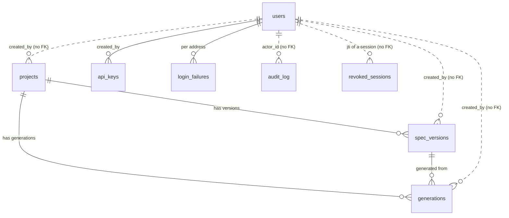
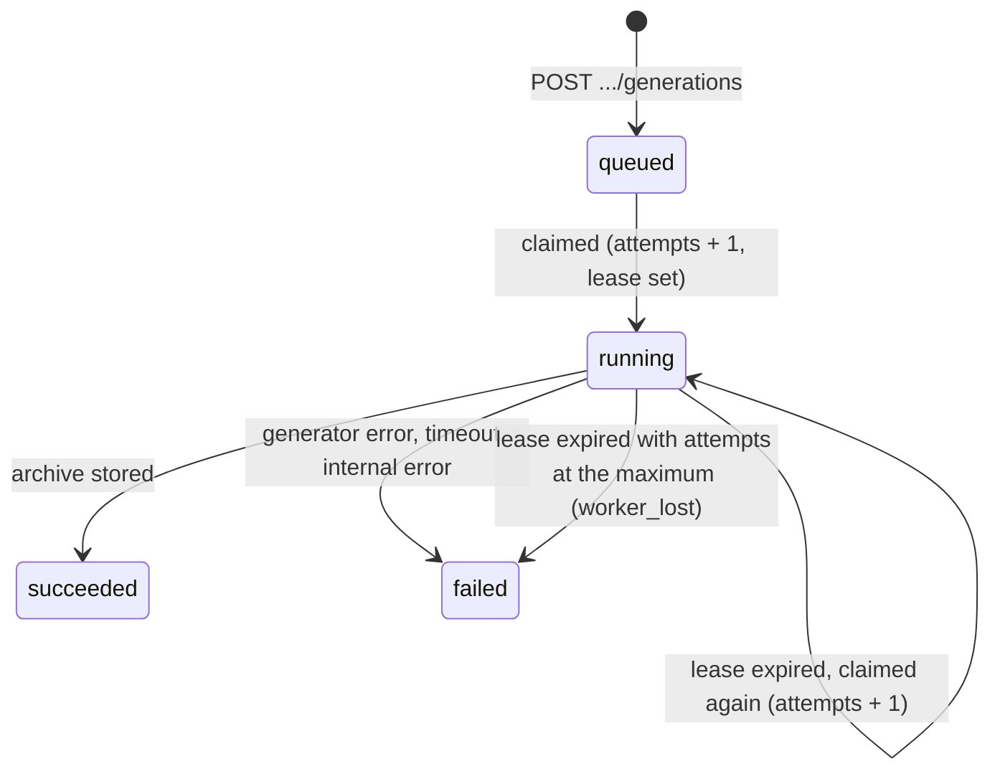

# Data Model

Every table is created by the first Alembic revision,
[`0001_initial_schema.py`](../../apps/api/src/apiforge_server/migrations/versions/0001_initial_schema.py),
generated from the SQLAlchemy models in each domain's `models.py`;
`0002_audit_action_index.py` adds one index to the audit log, and
`0003_login_failures_per_address.py` adds the `login_failures` table. Every migration
takes a Postgres advisory lock (one migrator at a time) and runs with
`lock_timeout = '10s'` ([`migrations/env.py`](../../apps/api/src/apiforge_server/migrations/env.py)),
and must stay backward compatible with the previous release, which keeps serving while
`aws-deploy.sh` migrates. New changes are new
revisions; an applied revision is never edited.

- [Conventions](#conventions)
- [Overview](#overview)
- [Projects and spec versions](#projects-and-spec-versions)
- [Generations](#generations)
- [Platform](#platform)
- [Object storage](#object-storage)
- [Retention summary](#retention-summary)

## Conventions

- **Ids:** UUID primary keys (generated in Python with `uuid4`) for everything except the
  audit log, which uses a `BIGINT` identity so keyset pagination follows insertion order,
  and `revoked_sessions`, keyed by the session token's `jti`.
- **Numbers per project:** spec versions and generations also carry a `number` that is
  unique within their project (`1, 2, 3, ...`). URLs use the project slug and that number
  (`/projects/pet-store/generations/3`), never the UUID.
- **Time:** every timestamp is `timestamptz`, stored and compared in UTC (the connection
  sets `timezone=UTC`).
- **Blobs live in object storage.** Spec bodies and generated archives are never stored in
  a row; rows keep the object key, the SHA-256 and the size.
- **JSONB** for structures the API returns as a whole and never filters on: generation
  options, lint reports, spec summaries, version changes, file manifests, audit details.
- **Foreign keys** where a row cannot exist without its parent (`spec_versions` and
  `generations` cascade from `projects`; `generations` cascades from `spec_versions`).
  `created_by` columns on projects, spec versions and generations are plain UUIDs without
  a constraint, so deleting a user (not possible through the API today) would never block
  on history; `api_keys.created_by` references `users`.

## Overview

## Projects and spec versions

### `projects`

An API the team generates from.

| Column | Type | Notes |
| ------ | ---- | ----- |
| `id` | uuid | Primary key |
| `slug` | varchar(80) | Unique; the URL name, derived from `name` (`pet-store`, `pet-store-2`) |
| `name` | varchar(120) | Display name |
| `description` | text | Default `""` |
| `default_options` | jsonb | `GenerationOptions`: `{project_name, db, docker, ci}`; what a new generation uses unless the request overrides it |
| `created_by` | uuid | The user who created it (no FK) |
| `created_at` | timestamptz | `now()` |
| `updated_at` | timestamptz | `now()`, also bumped by every spec upload so the project list sorts by activity |

Constraints: `UNIQUE (slug)`.

### `spec_versions`

One uploaded spec: stored in object storage, linted once, compared with the previous
version.

| Column | Type | Notes |
| ------ | ---- | ----- |
| `id` | uuid | Primary key (also part of the storage key) |
| `project_id` | uuid | FK `projects.id`, `ON DELETE CASCADE` |
| `number` | integer | 1, 2, 3, ... within the project |
| `filename` | varchar(255) | The sanitized upload name (`openapi.yaml`, `bundle.zip`) |
| `bundle` | boolean | A zip of documents with relative `$ref`s rather than one document |
| `storage_key` | varchar(512) | `specs/<project id>/<version id>/<filename>` |
| `sha256` | varchar(64) | Of the uploaded bytes; the idempotency key and the lint cache key |
| `size_bytes` | integer | |
| `title` | varchar(300) | `info.title` |
| `api_version` | varchar(100) | `info.version` |
| `openapi_version` | varchar(20) | `openapi` (`3.0.3`, `3.1.0`) |
| `operations` | integer | Operation count |
| `models` | integer | Generated model count |
| `errors` | integer | Report findings with severity `error`; above 0 blocks generation until accepted |
| `warnings` | integer | Report findings with severity `warning` |
| `report` | jsonb | `[{severity, code, message, pointer}]`, sorted by severity, pointer, code |
| `summary` | jsonb | `{operations: [{method, path, operation_id, function, tag, summary, deprecated, secured, schemes, responses}], tags: [{name, description, operations}], schemes: [{name, kind}], models: [...], fingerprints: {"METHOD /path": {parameters, request body, responses, security}}}` |
| `changes` | jsonb | Against the previous version: `{first, added: [...], removed: [...], changed: [{operation, parts}]}` |
| `note` | varchar(500) | Free text from the uploader (`"Orders and invoices"`) |
| `created_by` | uuid | No FK |
| `created_at` | timestamptz | `now()` |

Constraints and indexes:

- `uq_spec_versions_number UNIQUE (project_id, number)`: one version 3 per project, also
  the race guard when two uploads take the next number at once.
- `uq_spec_versions_sha UNIQUE (project_id, sha256)`: uploads are idempotent per project,
  even under concurrency.
- `ix_spec_versions_project_created (project_id, created_at)`: history per project.

## Generations

### `generations`

A spec version plus options, turned into a project archive by the worker. The table is
also the job queue ([ADR-0006](adr/0006-lease-based-worker-on-postgres.md)).

| Column | Type | Notes |
| ------ | ---- | ----- |
| `id` | uuid | Primary key (also part of the archive key) |
| `project_id` | uuid | FK `projects.id`, `ON DELETE CASCADE` |
| `spec_version_id` | uuid | FK `spec_versions.id`, `ON DELETE CASCADE` |
| `number` | integer | 1, 2, 3, ... within the project |
| `options` | jsonb | The `GenerationOptions` used (recorded in the archive's `apiforge.lock` too) |
| `accept_report` | boolean | Generated despite errors in the report |
| `status` | varchar(16) | `queued`, `running`, `succeeded`, `failed` |
| `attempts` | integer | Times a worker claimed it; above `GENERATION_MAX_ATTEMPTS` it fails with `worker_lost` |
| `lease_until` | timestamptz | While `running`: when another worker may take it over. Cleared when it finishes |
| `error_code` | varchar(64) | A generator code, `generation_timeout`, `internal_error` or `worker_lost` |
| `error` | text | What went wrong and what to do |
| `archive_key` | varchar(512) | `archives/<project id>/<generation id>.zip` |
| `archive_sha256` | varchar(64) | The archive's SHA-256: the download ETag and the file cache key |
| `archive_bytes` | integer | |
| `file_count` | integer | |
| `files` | jsonb | `[{path, owner, bytes}]`, sorted by path; `owner` is `generated` or `user`. The file browser only serves paths listed here |
| `summary` | jsonb | `{resources: [...], operations: n, models: n}` |
| `duration_ms` | integer | Of the last attempt |
| `created_by` | uuid | No FK |
| `started_at` | timestamptz | Set on each claim |
| `finished_at` | timestamptz | |
| `created_at` | timestamptz | `now()`; the queue's order |

Constraints and indexes:

- `uq_generations_number UNIQUE (project_id, number)`.
- `ix_generations_queue (status, created_at)`: the worker's claim
  (`status = 'queued' OR (status = 'running' AND lease_until < now)`, oldest first) and the
  queue-length gauge.
- `ix_generations_project_created (project_id, created_at)`: history per project.

State transitions:

## Platform

### `users`

| Column | Type | Notes |
| ------ | ---- | ----- |
| `id` | uuid | Primary key |
| `email` | varchar(320) | Unique; stored lower case, compared case-insensitively |
| `name` | varchar(200) | |
| `password_hash` | text | Argon2id |
| `role` | varchar(16) | `owner`, `admin` or `viewer` (default `viewer`) |
| `disabled` | boolean | A disabled user cannot sign in, and their sessions stop working |
| `last_login_at` | timestamptz | |
| `failed_logins` | integer | Account-wide failures from any address, counted atomically; reset on success or when a lock starts |
| `locked_until` | timestamptz | The account-wide lock: 15 minutes after the 50th failure. Per-address locks live in `login_failures` |
| `session_version` | integer | Bumped on password change, role change or disabling; sessions carrying an older value are refused |
| `created_at` | timestamptz | `now()` |

### `revoked_sessions`

Signed-out session tokens, refused until they would have expired anyway. Kept in Postgres,
not in a cache, so eviction can never bring a signed-out session back.

| Column | Type | Notes |
| ------ | ---- | ----- |
| `jti` | varchar(64) | Primary key: the token's id |
| `expires_at` | timestamptz | Indexed; rows past it are pruned on later sign-outs |

### `login_failures`

Sign-in failures per account and client address (revision
[`0003_login_failures_per_address.py`](../../apps/api/src/apiforge_server/migrations/versions/0003_login_failures_per_address.py)).
Five failures from one address lock that address out of that account for 15 minutes,
without locking the account for anyone else.

| Column | Type | Notes |
| ------ | ---- | ----- |
| `user_id` | uuid | FK `users.id`, `ON DELETE CASCADE`; part of the primary key |
| `ip` | varchar(64) | The client address as resolved through `FORWARDED_ALLOW_IPS` (empty when unknown); part of the primary key |
| `failures` | integer | Counted by an atomic upsert; reset when a lock starts |
| `locked_until` | timestamptz | Set to 15 minutes ahead at the fifth failure |

A successful sign-in from the address deletes its row.

### `api_keys`

Read-only bearer tokens for automation. Only a peppered HMAC of the secret is stored.

| Column | Type | Notes |
| ------ | ---- | ----- |
| `id` | uuid | Primary key |
| `name` | varchar(120) | `"CI download (read only)"` |
| `prefix` | varchar(16) | Unique; the 12 hex characters after `afk_`, the lookup key |
| `secret_hash` | varchar(64) | `HMAC-SHA256(API_KEY_PEPPER, secret)`, hex |
| `rpm_limit` | integer | Requests a minute; null means `DEFAULT_RPM_LIMIT` |
| `expires_at` | timestamptz | Optional |
| `revoked_at` | timestamptz | Set once by revoke; revoked keys are refused at once (config cache invalidated) |
| `last_used_at` | timestamptz | Written at most once a minute per key and process |
| `created_by` | uuid | FK `users.id` |
| `created_at` | timestamptz | `now()` |

### `audit_log`

Append-only. Written in the same transaction as the change it describes.

| Column | Type | Notes |
| ------ | ---- | ----- |
| `id` | bigint | Identity; keyset pagination key (newest first) |
| `at` | timestamptz | `now()`, indexed |
| `actor_id` | uuid | A user id, or an API key id for key actors |
| `actor_email` | varchar(320) | The user's email at the time |
| `action` | varchar(64) | `auth.login`, `auth.login_failed`, `auth.logout`, `auth.password_changed`, `user.created`, `user.updated`, `api_key.created`, `api_key.updated`, `api_key.revoked`, `project.created`, `project.updated`, `project.deleted`, `spec.uploaded`, `generation.queued` |
| `target_type` | varchar(32) | `user`, `api_key`, `project`, `spec_version`, `generation` |
| `target_id` | varchar(64) | |
| `details` | jsonb | Action specific (project slug, spec number, options, changed fields; never secrets) |
| `ip` | varchar(64) | The client address as resolved through `FORWARDED_ALLOW_IPS` |

Indexes: `ix_audit_log_at (at)` (revision 0001) and `ix_audit_log_action_id (action
varchar_pattern_ops, id)` (revision
[`0002_audit_action_index.py`](../../apps/api/src/apiforge_server/migrations/versions/0002_audit_action_index.py)),
which serves the API's action prefix filter (`?action=user.`), newest first.

A trigger, `audit_log_append_only`, runs `apiforge_refuse_change()` before every `UPDATE`
or `DELETE` and raises `check_violation`. Proven by
`tests/integration/test_admin.py::test_audit_log_records_changes_and_is_append_only`.

## Object storage

One bucket (`ARTIFACTS_BUCKET`) or one directory (`LOCAL_STORAGE_DIR`):

| Prefix | Object | Written by | Lifetime |
| ------ | ------ | ---------- | -------- |
| `specs/<project id>/<version id>/<filename>` | The uploaded bytes, exactly as received | The API on upload | Kept until the project is deleted |
| `archives/<project id>/<generation id>.zip` | The generated project | The worker | Expires after `archive_expiration_days` (90) on S3; kept on local disk |

On S3 every object is written with SSE-KMS; the bucket is versioned, private,
TLS-only and has a lifecycle rule for `archives/` and for noncurrent versions
([`infra/terraform/modules/storage`](../../infra/terraform/modules/storage)).

## Retention summary

| Data | Kept for | How |
| ---- | -------- | --- |
| Projects, spec versions, generation rows | Until the project is deleted | `ON DELETE CASCADE` from `projects` |
| Spec bodies | Until the project is deleted | Deleted best effort after the rows |
| Archives | `archive_expiration_days` (90 by default) on S3 | Bucket lifecycle rule; the row stays and the download answers 410 afterwards |
| Noncurrent object versions (a deleted spec, an expired archive) | `noncurrent_version_expiration_days` (30 by default) on S3 | Bucket lifecycle rule; until then a deleted spec can be recovered from its previous version |
| Revoked session ids | Until the token would have expired (12 h by default) | Pruned on later sign-outs |
| Audit log | Forever | The trigger refuses deletes; archive or partition it yourself if you must |
