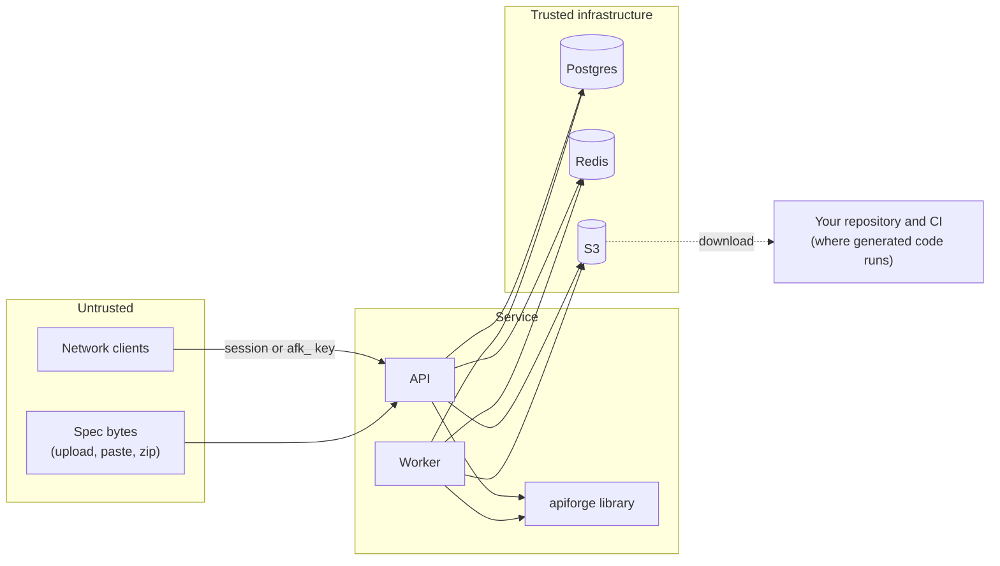

# Security

How APIForge protects the service, the people using it and the code it generates. The
attacker's view, threat by threat, is in [threat-model.md](threat-model.md). To report a
vulnerability, see [SECURITY.md](../../SECURITY.md).

- [What there is to protect](#what-there-is-to-protect)
- [Trust boundaries](#trust-boundaries)
- [Specs are untrusted input](#specs-are-untrusted-input)
- [Generated code is inert](#generated-code-is-inert)
- [No outbound calls, no execution](#no-outbound-calls-no-execution)
- [Uploads and storage](#uploads-and-storage)
- [The lock file on disk](#the-lock-file-on-disk)
- [Authentication](#authentication)
- [Roles](#roles)
- [Read-only API keys](#read-only-api-keys)
- [The worker](#the-worker)
- [Secrets at rest](#secrets-at-rest)
- [Metrics endpoint](#metrics-endpoint)
- [Audit log](#audit-log)
- [Logs, errors and headers](#logs-errors-and-headers)
- [The generated project's own security](#the-generated-projects-own-security)
- [Production boot guards](#production-boot-guards)
- [Operator checklist](#operator-checklist)
- [Residual risks](#residual-risks)

## What there is to protect

| Asset | Why it matters |
| ----- | -------------- |
| Uploaded specs | They describe internal APIs: endpoints, data models, auth schemes, sometimes example data |
| Generated archives | Code your team will run; tampering with one would plant code in your service |
| The service host | A spec that makes the server fetch URLs or run code would turn APIForge into a foothold |
| Accounts, sessions and API keys | They gate everything above |
| The audit log | The record of who uploaded, generated and changed what |

## Trust boundaries

The spec crosses into the service as data and must stay data: while it is parsed, while it
is turned into code, and inside the code it becomes. Generated code crosses back out as an
archive and runs only on your machines.

## Specs are untrusted input

The same loader runs on the CLI and in the service
([`loader.py`](../../apps/forge/src/apiforge/loader.py),
[`bundles.py`](../../apps/forge/src/apiforge/bundles.py)):

| Control | Limit |
| ------- | ----- |
| Document size | 5 MiB per file (`MAX_BYTES`); the service also refuses uploads over `MAX_SPEC_BYTES` and bodies over `MAX_BODY_BYTES` |
| Multi-file specs | At most 200 files and 20 MiB in total |
| YAML | A `SafeLoader` subclass: no tags, no Python objects; timestamps stay strings |
| YAML aliases | At most 10,000 alias events while composing |
| Expansion | At most 2,000,000 values visited after loading (what bounds a "billion laughs" document whose aliases are shared, not copied) |
| Nesting | At most 64 levels; a `RecursionError` in the parser is a refusal, not a crash |
| Keys and values | Only string keys and JSON scalar types |
| Zip | Declared sizes checked before decompression, each member read with a cap (a lying header is caught), absolute paths and `..` refused, `__MACOSX/` and dot files skipped, only `.yaml`, `.yml` and `.json` read |
| `$ref` | Only to the same document or to another file of the same spec; URLs (`http://`, `//host`) are refused with a message; a relative path that leaves the spec's folder is refused; a JSON pointer segment with a non-ASCII digit is a ref error, not a crash. Every `$ref` key anywhere in the spec is checked before the validator runs, so the validator never meets a remote reference |
| `$ref` fan-out | Inlining references is bounded at 500,000 schema nodes per spec (`MAX_EXPANDED_NODES`). Schemas that reference each other many times over (24 properties all pointing at their own schema fit in under 1 KB) are refused with `spec_too_complex` in a fraction of a second instead of taking gigabytes of memory; the bundled 240-operation spec needs about 12,000 nodes (`tests/test_budgets.py`) |
| Text | Unpaired UTF-16 surrogates (`"\ud800"` escapes) in keys or strings are refused at load (`spec_unreadable`); zips with encrypted entries, unsupported compression or corrupt members are refused the same way, never a 500 |

Every refusal is a `ForgeError` with a code and a message that says what to do. In the
service it becomes a 422 carrying that code; nothing is stored.

Proven by `apps/forge/tests/test_loader.py` (alias bombs, tags, size and depth, URL refs,
escaping refs, zips) and `apps/api/tests/integration/test_hardening.py`
(`test_zip_bombs_and_yaml_bombs_are_refused_before_doing_the_work`,
`test_a_spec_with_url_refs_never_makes_the_server_fetch`).

## Generated code is inert

A spec controls names, descriptions, examples, patterns, defaults and enum values. None of
that may become code.

- **Names are made safe once.** `normalize` turns every spec name into a valid, non-keyword
  Python identifier through `naming.py` and keeps the original as the `wire` name. Templates
  only ever see the safe name in identifier positions.
- **Text goes through filters.** In
  [`render.py`](../../apps/forge/src/apiforge/render.py), spec text reaches a template only
  through `lit` (a Python literal built by `py_literal`), `doc` (an escaped docstring) or
  `comment` (a single comment line). There is no filter that emits raw spec text.
- **The environment is sandboxed and strict.** Jinja's `SandboxedEnvironment` (templates
  cannot reach Python internals) with `StrictUndefined` (a missing variable is an error,
  never an empty string).
- **Computed in Python, not in templates.** Signatures, decorators and import lists are
  built in [`targets/fastapi/plan.py`](../../apps/forge/src/apiforge/targets/fastapi/plan.py),
  so templates contain almost no logic to get wrong.
- **Formatting is a check.** The pinned ruff binary formats every generated Python file; a
  syntax error makes formatting fail and generation stop with a message that includes
  ruff's output, instead of shipping broken code.
- **Proof.** `apps/forge/tests/test_hostile.py` generates a spec built to break out of
  identifiers, strings, docstrings and comments and checks the output compiles, passes mypy
  and contains no spec text outside literals and comments; Hypothesis property tests feed
  arbitrary text to `py_literal`, `docstring` and the identifier builder.
  `test_corpus.py::test_a_hostile_spec_generates_a_project_that_passes_its_gates` installs
  that project and runs its gates.

## No outbound calls, no execution

- The service has no outbound HTTP client. The container's
  [docstring](../../apps/api/src/apiforge_server/core/container.py) says so and the code
  holds it: the only network peers are Postgres, Redis and S3. A spec's `servers`,
  `externalDocs`, OpenID Connect URLs and `$ref` URLs are never requested
  ([ADR-0008](adr/0008-never-fetch-url-refs.md)).
- The generator opens no socket. `apps/forge/tests/test_generator.py::test_generating_needs_no_network`
  replaces `socket.socket` with a function that fails the test.
- The service never executes generated code. The worker renders templates and runs the
  pinned ruff formatter on files it just wrote into a private temporary directory; it never
  imports, installs or runs the generated project. `apiforge verify` (which does install and
  run the project) exists only on the CLI.

## Uploads and storage

- File names are reduced to their last path component and the characters
  `[A-Za-z0-9._-]`, at most 120 characters, with a spec suffix enforced. The object key is
  `specs/<project uuid>/<version uuid>/<name>`, so a user-chosen name never decides the
  folder.
- `LocalStorage` resolves every key and refuses one that would leave its root
  (`tests/unit/core/test_storage.py::test_local_storage_refuses_path_traversal`,
  `tests/integration/test_hardening.py::test_uploaded_file_names_cannot_escape_the_storage_folder`).
- The file browser serves only paths in the generation's stored manifest, from the archive
  whose SHA-256 the row records.
- On S3, objects are written with SSE-KMS; the bucket is private, versioned, TLS-only and
  owner-enforced. Task roles may only read and write `specs/*` and `archives/*`.

## The lock file on disk

`apiforge generate` into an existing folder trusts `apiforge.lock` to know which files it
generated. A lock is just a file in a repository, so a hostile one (from a cloned repository
or a pull request) must not be able to steer the writer. Entries are trusted only for
relative paths under `app/generated/` or `tests/generated/` that resolve inside the
project ([`writer.py`](../../apps/forge/src/apiforge/writer.py) `_generated_path`);
absolute paths, backslashes, `.` or `..` segments and anything elsewhere are ignored, with
or without `--force`, and `operations` entries that are not objects are ignored. Proven by
`tests/test_writer.py::test_a_hostile_lock_file_cannot_delete_outside_the_generated_folders`.

## Authentication

- **Passwords:** Argon2id (argon2-cffi defaults), at least 10 characters with upper and
  lower case letters and a digit. Unknown emails are verified against a dummy hash so they
  take the same time as known ones.
- **Lockout:** 5 consecutive failures lock the account for 15 minutes; failures are
  counted with one atomic `UPDATE ... RETURNING`, so parallel guesses cannot share a count.
  Per address, 20 attempts a minute (KV store). The client address comes from uvicorn's
  proxy-header handling, which trusts `X-Forwarded-For` only from `FORWARDED_ALLOW_IPS`.
- **Sessions:** HS256 JWTs signed with `SESSION_SECRET`, audience `apiforge-dashboard`, a
  random `jti`, the user's `session_version`, 12 hour expiry (`SESSION_TTL_HOURS`). The web
  app gets it in the `af_session` cookie (`HttpOnly`, `SameSite=Lax`, `Secure` when
  `COOKIE_SECURE`); API clients get it in the login response and send it as a bearer token.
- **Sign-out** records the `jti` in `revoked_sessions` (Postgres) until the token would
  have expired. **Password change, role change and disabling** bump `session_version`, which
  ends every other session at once.
- **CSRF:** a cookie-authenticated `POST`, `PUT`, `PATCH` or `DELETE` must carry
  `X-APIForge-CSRF: 1`. A browser cannot add a custom header to a cross-site request
  without a CORS preflight, which the allowlist refuses. Bearer-authenticated requests need
  no header (browsers never attach one cross-site).

## Roles

| Role | Can |
| ---- | --- |
| `viewer` | Read everything a project shows: specs, reports, diffs, generations, files, archives; use the playground |
| `admin` | Everything a viewer can, plus create, change and delete projects, upload specs, request generations, manage API keys, read users and the audit log |
| `owner` | Everything, plus create users and change roles and access |

One dependency per route (`Viewer`, `Admin`, `Owner`) decides access. Owners cannot change
their own role or disable themselves; the last active owner cannot be demoted or disabled
(owner rows are locked while counting, so two owners demoting each other at once still
leave one). Proven by `tests/integration/test_admin.py::test_roles_are_enforced`,
`test_users_keep_an_owner` and `test_hardening.py::test_two_owners_demoting_each_other_keep_an_owner`.

## Read-only API keys

- Format `afk_<12 hex prefix>_<43 character secret>`; the prefix is the lookup key and the
  secret is stored only as `HMAC-SHA256(API_KEY_PEPPER, secret)`, compared in constant
  time. The plaintext is shown once at creation.
- A key acts as a viewer and may only use `GET`, `HEAD` and `OPTIONS`; anything else is 403
  `read_only_key` before the route runs.
- Per-key rate limit (`rpm_limit`, or `DEFAULT_RPM_LIMIT`, 600 a minute), optional
  expiry, immediate revocation (the config cache is invalidated cluster-wide).
- Malformed keys are refused before they reach the cache or the database.

## The worker

- Claims are transactional and leased, so a worker that dies does not lose its
  generation ([service.md](service.md#the-worker)). No transaction is held while the
  generator runs; the result is written only after the row is locked and its `attempts`
  still matches this claim, so a worker whose lease expired (and whose job another worker
  took) records nothing (`generation lease lost`). A project deleted mid-generation leaves
  no archive behind.
- Every generation runs under `GENERATION_TIMEOUT_S`; a spec that would make the generator
  loop or allocate without bound is cut off and recorded, and after
  `GENERATION_MAX_ATTEMPTS` crashes it stops being retried.
- Errors are recorded on the row for the user; tracebacks stay in the worker log.

## Secrets at rest

| Secret | Where | Notes |
| ------ | ----- | ----- |
| User passwords | `users.password_hash` | Argon2id |
| API key secrets | `api_keys.secret_hash` | Peppered HMAC; the pepper is in the environment (Secrets Manager on AWS) |
| `SESSION_SECRET`, `API_KEY_PEPPER` | Environment | Must differ: rotating sessions must not invalidate every API key |
| `METRICS_TOKEN` | Environment | Optional |
| Database and cache URLs | Environment | Secrets Manager on AWS |

On AWS these are generated by Terraform into Secrets Manager and injected by ECS, never
written into a task definition ([`modules/secrets`](../../infra/terraform/modules/secrets)).
Locally `make env` writes random values into the git-ignored `deploy/compose/.env`.

## Metrics endpoint

`/metrics` requires `Authorization: Bearer <METRICS_TOKEN>` when the token is set (compared
in constant time). On AWS the token is always generated, and the ALB can additionally limit
`/metrics` to `metrics_allowed_cidrs`. The worker's metrics port (9464) is reachable only
from `worker_metrics_cidrs` inside the VPC. Metrics carry counts and timings, never spec
content or user data.

## Audit log

Every change through the API writes an `audit_log` row in the same transaction as the
change: sign-in (and failures), sign-out, password changes, users, API keys, projects, spec
uploads and generation requests. A database trigger refuses `UPDATE` and `DELETE` on the
table. Admins read it at `GET /api/v1/audit`.

## Logs, errors and headers

- JSON logs; fields named like credentials (`authorization`, `password`, `secret`,
  `token`, `api_key`) are redacted whatever a caller puts in them.
- SQLAlchemy runs with `hide_parameters=True`, so bound values (hashes, spec content) never
  appear in an exception message or a log line.
- One error envelope, no stack traces in responses.
- Security headers on every response: `X-Content-Type-Options: nosniff`,
  `X-Frame-Options: DENY`, `Referrer-Policy: no-referrer`,
  `Cross-Origin-Opener-Policy: same-origin`, a restrictive `Permissions-Policy`.
- Login responses are `Cache-Control: no-store`.

## The generated project's own security

What APIForge puts into the projects it generates:

- Security dependencies for every scheme the spec declares (bearer, OAuth2 and OpenID
  Connect as JWT with scopes, API keys in a header, query or cookie, HTTP basic). A missing
  or invalid credential is 401, a missing scope 403. Operations without security stay open,
  as the spec says.
- `app/auth.py` (yours) fails closed: an empty `JWT_SECRET` accepts no token; API keys and
  basic passwords are compared in constant time, with the same work for unknown basic
  users.
- `app/config.py` (yours) refuses to start with `APP_ENV=production` and a `JWT_SECRET`
  under 32 characters, an API key under 24, a basic password under 16, or `*` in
  `CORS_ORIGINS`.
- `.env.example` carries no secrets; `.gitignore` excludes `.env`.

The details and how to replace the defaults are in
[generated-project.md](../guides/generated-project.md#authentication).

## Production boot guards

With `ENVIRONMENT=production`, `Settings.guard()`
([`core/config.py`](../../apps/api/src/apiforge_server/core/config.py)) refuses to start
when:

- `SESSION_SECRET` or `API_KEY_PEPPER` is a known placeholder, contains
  `not-for-production`, or is shorter than 32 characters;
- `SESSION_SECRET` equals `API_KEY_PEPPER`;
- `APIFORGE_CLOUD=aws` and `AWS_ENDPOINT_URL` is set;
- `COOKIE_SECURE` is false;
- `STORAGE=local` (local disk is per container).

## Operator checklist

- Run with `ENVIRONMENT=production` and let the guards pass; never weaken them.
- Serve over HTTPS only; set `COOKIE_SECURE=true` and `CORS_ORIGINS` to your web origin.
- Set `FORWARDED_ALLOW_IPS` to your load balancer's network, never `*` on a public host.
- Set `METRICS_TOKEN`, and restrict `/metrics` at the load balancer if you can.
- Use Redis when you run more than one API process, so rate limits are shared.
- Give API keys an expiry and the narrowest rate limit CI needs; revoke unused ones.
- Keep at least two owners; review the audit log.
- Do not run `seed-demo` on a real deployment: it creates well-known demo logins (it
  refuses to run with `ENVIRONMENT=production`).
- Review generated code like any other code before you run it; regenerate rather than edit
  `app/generated/`.

## Residual risks

- A user with a viewer role (or a read-only key) can read every project's specs and
  archives; there is no per-project access control in 0.1.0.
- Linting and generation are bounded but CPU heavy; an admin can queue many generations of
  a large spec. Rate limits apply to API keys and sign-in, not to signed-in admins.
- `GENERATION_TIMEOUT_S` bounds how long the worker waits, not the thread itself: a
  generation that times out keeps running in the background until it finishes.
- `seed-demo` refuses `ENVIRONMENT=production`, but a deployment misconfigured as
  development would accept it (it needs shell access to the container either way).
- The audit trigger stops the application, not a database superuser.
- Every `$ref` key anywhere in a spec, even inside an `example`, is checked to be local
  before validation. A literal `{"$ref": "https://..."}` in example data is refused, and
  anchor refs (`#foo`) are refused as "not a JSON pointer". This is deliberate: the
  validator can never meet a remote reference.
