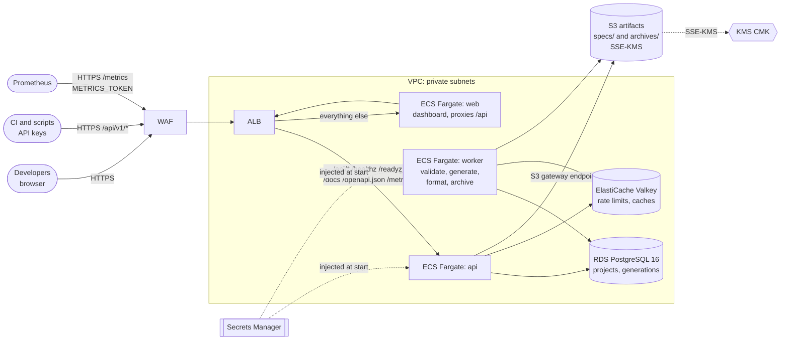

# Infrastructure

Everything needed to run Euron Open APIForge, from a laptop to a multi-AZ AWS
deployment, as code.

```
infra/
├── docker/        Multi-stage, non-root images: api (API, worker, CLI; built from the repo
│                  root with apps/forge and apps/api), web (dashboard)
└── terraform/
    ├── modules/   network · kms · storage · secrets · database · cache · ecr ·
    │              service · observability
    └── envs/
        ├── local-floci/   storage + kms + secrets on the Floci emulator (applied by `make up`)
        ├── aws-dev/       full stack, cost-lean (2 AZs, single NAT, single-AZ DB, one cache node)
        └── aws-prod/      full stack, resilient (3 AZs, NAT per AZ, Multi-AZ DB, cache failover)
```

## One codebase, two clouds

The modules are the same in every environment. `local-floci` points the AWS
provider at the emulator (`http://floci:4566` inside compose) and turns off
only what an HTTP-only emulator cannot do (the TLS-only bucket policy). `make up`
applies it automatically before migrate, api and worker start, and the API then
stores uploaded specs and generated archives in S3 (`apiforge-local-artifacts`,
SSE-KMS with `alias/apiforge-local`) exactly as it does on AWS. The application
switches between the two through environment variables only (`AWS_ENDPOINT_URL`,
`S3_FORCE_PATH_STYLE`, `STORAGE`, `ARTIFACTS_BUCKET`); there are no emulator branches in
the code.

| Resource | Local (Docker) | AWS (module) |
|---|---|---|
| PostgreSQL 16: users, sessions, API keys, projects, spec metadata, generation jobs, audit log | `postgres:16` container | RDS PostgreSQL (`database`) |
| Rate limits and short-lived caches (optional) | `redis:7` container | ElastiCache Valkey, TLS + AUTH (`cache`) |
| Uploaded specs (`specs/`, kept) and generated archives (`archives/`, 90 days) | local volume, or S3 on Floci | S3 (`storage`) |
| Encryption at rest (the app never calls KMS itself) | KMS on Floci | KMS (`kms`) |
| Signing secrets, metrics token, connection URLs | Secrets Manager on Floci | Secrets Manager (`secrets`) |
| api, worker, web | Compose services from the same images | ECR (`ecr`) + ECS Fargate behind one ALB (`service`) |
| Logs, metrics, alarms | stdout + `/metrics` | CloudWatch (`observability`) |

## AWS topology (aws-dev / aws-prod)



The service makes no outbound calls of its own: task egress is HTTPS to AWS APIs and
ECR only. Generation runs entirely inside the worker task (render in `/tmp`, format with
the bundled ruff binary, check, archive to S3).

## Order of operations (first deploy)

1. Request an ACM certificate for your host name in the target region.
2. `cp envs/aws-dev/terraform.tfvars.example envs/aws-dev/terraform.tfvars` and fill it in
   (optionally `backend.tf.example` to `backend.tf` for S3 state).
3. `terraform -chdir=infra/terraform/envs/aws-dev init`
4. `terraform -chdir=infra/terraform/envs/aws-dev apply -target=module.ecr`
5. Build both images for `linux/arm64` and push them with the `image_tag` from your tfvars.
   The api image builds from the repository root:
   `docker buildx build --platform linux/arm64 -f infra/docker/api.Dockerfile -t <api repo>:<tag> --push .`
   (and `web.Dockerfile` with the `apps/web` context).
6. `terraform -chdir=infra/terraform/envs/aws-dev apply`
7. Run the migration task with the `run_task` output (`aws ecs run-task ... --launch-type FARGATE`),
   then `create-owner` the same way with a command override
   (`["create-owner", "--email", "you@example.com"]` and `APIFORGE_OWNER_PASSWORD` in the override environment).
8. Point DNS at `load_balancer_dns_name` if the zone is not in Route53 and sign in at the
   `url` output.
9. For Prometheus, read `METRICS_TOKEN` from the `metrics_token_secret_arn` output and
   scrape `https://<hostname>/metrics` with it (optionally also limited to
   `metrics_allowed_cidrs`).

`make aws-deploy ENV=aws-dev TAG=0.1.0` (scripts/aws-deploy.sh) runs steps 3 to 7 in one go.
The full runbook is in [docs/guides/deploy-aws.md](../docs/guides/deploy-aws.md).
This repository itself only ever validates `aws-dev` and `aws-prod` (and applies
`aws-dev` to a throwaway Floci with `make tf-aws-on-floci`); nothing is applied to a
real account by the project's own tooling.

## Security posture at a glance

| Control | Where |
|---|---|
| No static AWS credentials anywhere (task roles and the default chain only) | all modules |
| Least-privilege IAM per app: `specs/*` and `archives/*` objects in the artifacts bucket, KMS only via S3; web has none | service |
| Private subnets for every runtime; no public IPs; ingress only from the ALB, none for the worker (Prometheus on 9464 only from listed in-VPC CIDRs) | network, service |
| Egress HTTPS only, to AWS APIs and ECR; the service makes no other outbound calls | service |
| TLS everywhere: ALB TLS 1.3/1.2 policy, `rds.force_ssl`, ElastiCache `transit_encryption_mode = required`, TLS-only bucket policy | service, database, cache, storage |
| Encryption at rest with a rotating CMK (RDS, ElastiCache, S3, ECR, secrets, logs) | kms + consumers |
| Uploaded specs versioned (recoverable after an overwrite or delete); archives expire after 90 days | storage |
| Generated secrets (signing keys, metrics token, DB password, cache AUTH token) injected by ECS, never in task definitions | secrets, database, cache |
| Cache data is rebuildable (`allkeys-lru`): a full cache drops cached reads, never data; a memory alarm warns first | cache, observability |
| WAF managed rules and a per-IP flood guard; spec upload bodies only counted, not blocked | service |
| `/metrics` requires `METRICS_TOKEN`, optionally also limited to listed CIDRs at the ALB | service, secrets |
| Alarms on 5xx, p95 latency, unhealthy targets, ECS, RDS, cache, failed worker jobs and failed generations | observability |
| Read-only root filesystems, non-root containers, init process for graceful drain | docker, service |
| Static analysis: `terraform validate`, tflint, checkov (inline, reasoned skips only) | `make tf-validate tf-lint tf-security` |
